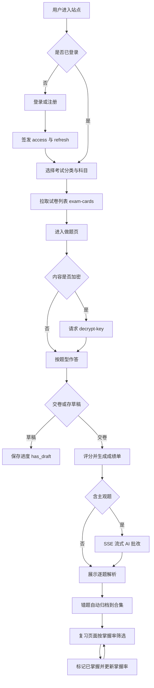
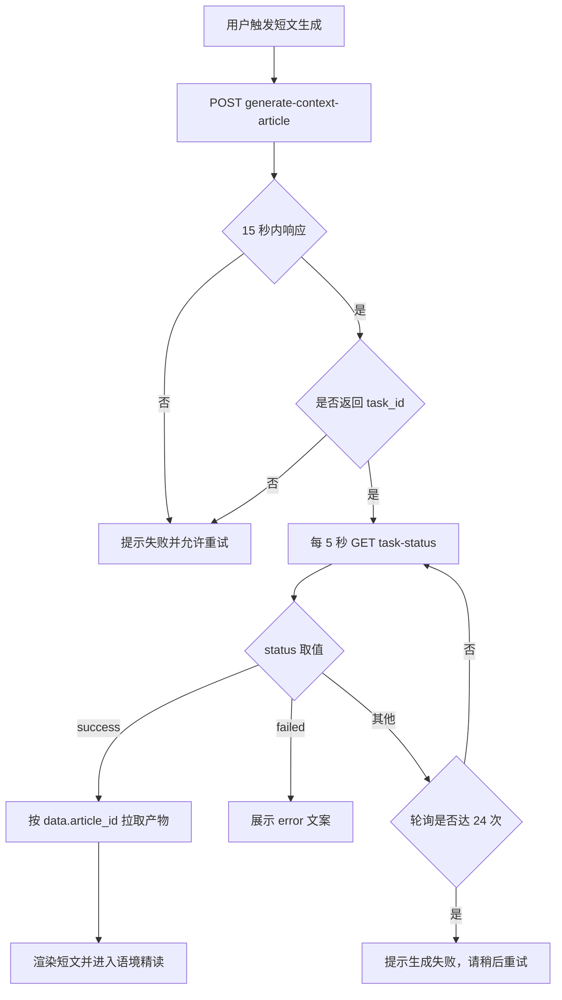
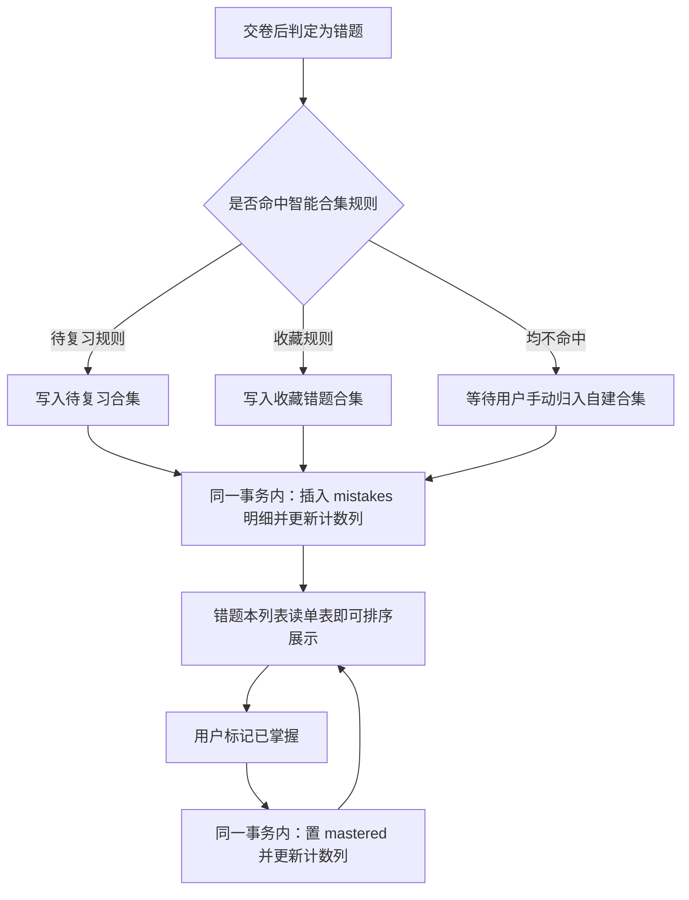

# 设计文档：考试备考平台（ExamCrafts 同类产品）技术方案

- 日期：2026-10-15
- 状态：草稿

## 1. 需求理解

用户希望自建一个与 `https://examcrafts.com/` 同类的在线考试备考平台，面向中国大学生（四六级 / 专四专八 / 考研），核心能力是「刷题 + AI 批改 + 错题生词归档 + 笔记」。本方案基于对该站点公开前端资源（52 个懒加载 chunk 全部取得）与运行时行为的分析，产出可直接开工的技术设计。

**已确证的参照事实**（来源见附录）：

- 前端：Vue 3 + Vite + Pinia + vue-router 4.6.3，UI 用 Tailwind（CSS 中 1284 处 `--tw-`）+ daisyUI（`<html data-theme="cupcake">`），图标 Lucide，平滑滚动 Lenis，公式 KaTeX，Markdown marked，PDF 相关能力（`index-C-mmH9Q6.js` 内含 pdf 处理代码）。
- 后端：Django REST Framework（分页 `count/next/previous/results`、错误体 `{"detail":"身份认证信息未提供。"}`）+ SimpleJWT（`/api/auth/token/refresh/`）。
- 部署：前端 `examcrafts.com` 与 API `admin.examcrafts.com` **分属不同子域**，前置腾讯云 EdgeOne（未带挑战态的裸请求返回约 988 字节 JS 挑战页，须真实浏览器环境）。
- AI 能力有**两种调用模式**：交互式走 SSE 流式（`ReadableStream` + `getReader()`，无 WebSocket）；长耗时的生成类任务走**异步任务 + 轮询**（提交拿 `task_id`，每 5 秒轮询一次，上限 24 次共 2 分钟）。
- 鉴权为**默认拒绝**模型：`/api/` 根路径返回 401，仅公告等少数接口放开。
- 已确证 **55 条路由**（完整表见 4.0）与 **40+ 条 API**（完整清单见 2.7）。
- API 主机硬编码在 core bundle 中：`https://admin.examcrafts.com`。
- 令牌存于 `localStorage`，键名 `access_token` / `refresh_token`。
- 前端内置**客户端限流器**与 **401 并发刷新去重**机制（见 2.8），是本项目应直接复用的两处实现。

**关键假设**：

1. 全新项目，无历史包袱，不涉及对既有系统的兼容。
2. 技术选型沿用参照实现（Django + DRF + Vue 3），以降低设计风险。
3. 考试分类体系复用「5 大类 / 分类下多科目」结构，但**一期范围已收敛为英语垂直**：CET4 / CET6 / IELTS Academic（听力、阅读、写作三科），其余分类与考研均移出一期。范围变更与由此产生的数据模型见 [`0002-考试内容与题型模型.md`](0002-考试内容与题型模型.md)。
4. 题目内容由本项目自建或取得授权，**不搬运参照站点的任何题库内容**（其页脚明确声明真题版权属出题方）。
5. AI 能力通过第三方 API 接入，不自研模型。**一期范围为英语垂直（CET4/CET6/IELTS Academic），作文批改模型选用 DeepSeek，于二期接入**；参照站点使用的是硅基流动与讯飞星火，本项目不沿用其选型。
6. 笔记功能的「卡片」与「社区分享」两套拆开实施，首期只做卡片。

**待确认事项**：

1. 试卷内容加密方案（有 `/api/exams/decrypt-key` 端点，但 52 个 chunk 中均未观察到实际加解密调用，算法、密钥分发与轮换策略未知）。
2. 考研 AI 对话接口 `/api/exams/kaoyan/sessions/{id}/chat-with-ai/` 的请求体与 SSE 分片格式（仅确证端点存在）。
3. 生词复习的**间隔调度算法**：前端只确证「困难 / 中等 / 简单」三档难度反馈，未见 `interval` / `ease` / `next_review` 等服务端字段，故算法在服务端且未观察。
4. 图形验证码 `/api/auth/captcha/refresh/` 的请求参数与返回结构。
5. 试题正文、作答记录的实际数据结构（需登录态并解密才能观察，未采集）。
6. 第三方 AI/翻译服务的接入凭据与计费方式（作文批改已定 DeepSeek，其余待定）。

**关于「完整架构」的边界说明**

本轮已完成 52 个 chunk 的静态应用图分析（53 个文件 / 2.6MB / 536,437 AST 节点 / 3,511 findings / 0 解析失败），产出 **55 条路由表**、客户端限流与令牌刷新实现、以及各模块数据模型。

**以下三项在原理上无法通过静态分析获得，本方案不以还原它们为目标**：

- **题目正文结构**：位于 `/api/exams/decrypt-key` 之后，需以真实用户身份解密，属受保护内容。
- **少数写接口的请求体形状**（`submissions` 的 POST、`feedbacks`、`security_reports`）：需登录态实际触发才能观察。
- **服务端内部实现**：永远不可见。

这三项不构成开工阻碍：**请求体形状应由本项目后端设计决定，无必要与参照实现逐字节一致**；题目结构取决于自建题型设计。逐条依据见附录「未确证项」。

## 2. 接口改动

本仓库当前无任何实现代码，故不存在「修改」与「废弃」；以下为**全新接口设计**。接口风格、命名与响应形状沿用参照实现，以便直接对照验证。

**统一约定**

- 基础路径 `/api/`，除个别第三方风格端点外全部以 `/` 结尾（DRF 约定），JSON 请求与响应。
- 分页响应形状：`{"count": int, "next": url|null, "previous": url|null, "results": [...]}`。
- 错误响应形状：`{"detail": "中文说明"}`；字段级错误沿用 DRF 默认的 `{"field": ["消息"]}`。
- 鉴权：`Authorization: Bearer <access>`；全局默认 `IsAuthenticated`，公开接口显式放开。
- 枚举字段一律「机器值 + `_display` 中文名」成对返回。
- 资源 ID 策略：公开资源用自增整数（试卷、题目），用户私有且可能跨端同步的资源用 UUID（错题合集、笔记卡片、生词本）。

### 2.1 认证

| 方法 | 路径 | 入参 | 出参 | 错误码 |
|---|---|---|---|---|
| POST | `/api/auth/register/` | `username`, `password`, `email?` | `{user_id, username}` | 400 / 409 |
| POST | `/api/auth/login/` | `username`, `password`, `captcha_token?` | `{access, refresh}` | 401 / 429 |
| POST | `/api/auth/logout/` | `refresh` | 204 | 401 |
| POST | `/api/auth/token/refresh/` | `refresh` | `{access}` | 401 |
| GET | `/api/auth/profile/` | — | `{id, username, avatar, ...}` | 401 |
| GET | `/api/auth/captcha/refresh/` | 待确认 | 待确认（预期含图形与校验标识） | — |
| POST | `/api/auth/wechat/login/` | 授权 code | `{access, refresh}` | 401 |
| POST | `/api/auth/wechat/register/` | 授权 code | `{access, refresh}` | 400 / 409 |

兼容性影响：无（新增）。`captcha_token` 与微信两条链路首期不实现，接口返回 501，前端隐藏入口。

### 2.2 考试内容

| 方法 | 路径 | 入参 | 出参 | 错误码 |
|---|---|---|---|---|
| GET | `/api/exams/exam-cards/` | query：`subject`, `year`, `month` | 分页的 ExamCard（见 3.1） | 401 |
| GET | `/api/exams/exam-cards/{id}/` | — | 单个 ExamCard | 404 |
| GET | `/api/exams/cet/topic/list/` | query：`level?` | 四六级专项训练列表 | 401 |
| GET | `/api/exams/decrypt-key/` | query：`exam_id` | `{key_id, key, algorithm, expires_at}` | 401 / 403 / 409 |
| POST | `/api/exams/submissions/` | `exam_id`, `answers[]`, `is_draft` | `{submission_id, score, is_draft}` | 400 / 409 |
| GET | `/api/exams/submissions/?exam_id=` | — | 分页的作答记录 | 401 |
| GET | `/api/exams/submissions/{id}/analysis/` | — | 逐题解析与得分 | 404 |

`answers[]` 元素：`{"question_id": int, "answer": str|list, "spent_ms": int}`。`is_draft=true` 不评分、仅存进度，对应 `has_draft` 字段。

兼容性影响：无（新增）。`decrypt-key` 首期返回 501，前端按「明文内容」分支处理——**该分支必须首期写好，否则后续加密需改动整条数据流**。

### 2.3 AI 能力（两种模式）

**模式 A：SSE 流式（交互式，用户等待）**

| 方法 | 路径 | 入参 | 出参 | 错误码 |
|---|---|---|---|---|
| POST | `/api/exams/cet/grading/` | `exam_id`, `part`(`writing`\|`translation`), `content` | SSE：`{delta, done, score?, comments?}` | 401 / 429 |
| GET | `/api/exams/kaoyan/sessions/{id}/chat-with-ai/` | query：`question` | SSE：`{delta, done}` | 401 / 404 / 429 |

**模式 B：异步任务 + 轮询（长耗时生成，用户可离开）**

| 方法 | 路径 | 入参 | 出参 | 错误码 |
|---|---|---|---|---|
| POST | `/api/common/generate-context-article/` | `words`(逗号分隔), `count`, `topic`, `difficulty` | `{task_id}` | 400 / 429 |
| POST | `/api/common/generate-context-question-analysis/` | 待确认 | `{task_id}` | 400 / 429 |
| GET | `/api/common/task-status/{task_id}/` | — | `{status, data:{article_id?}, message, error}` | 404 |
| GET | `/api/context-articles/{id}/` | — | 生成的短文详情 | 404 |

异步任务的**前端契约已确证，须照此实现**：提交请求超时 15 秒；随后每 5 秒轮询一次 `task-status`，最多 24 次（总计 2 分钟）；`status` 取值为 `success` / `failed` / 其他（视为进行中）；`success` 时从 `data.article_id` 取产物，`failed` 时展示 `error`，轮询耗尽则提示「生成失败，请稍后重试」。轮询期间单次请求失败不终止循环。

兼容性影响：无（新增）。AI 不可用时模式 A 返回 503 并降级为「仅显示参考答案」，模式 B 返回 `status:"failed"`。

### 2.4 错题本

| 方法 | 路径 | 入参 | 出参 | 错误码 |
|---|---|---|---|---|
| GET | `/api/exams/mistake-collections/` | query：`category`, `ordering` | 分页的集合（见 3.3） | 401 |
| POST | `/api/exams/mistake-collections/` | `name`(必填), `description?`, `category?` | 新建的集合 | 400 |
| PATCH | `/api/exams/mistake-collections/{id}/` | `name?`, `description?` | 更新后的集合 | 400 / 404 |
| DELETE | `/api/exams/mistake-collections/{id}/` | — | 204 | 403 内置集合禁删 |
| GET | `/api/exams/mistakes/` | query：`collection_id`, `mastered` | 分页的错题条目 | 401 |
| PATCH | `/api/exams/mistakes/{id}/` | `mastered?`, `collection_id?` | 更新后的条目 | 404 |

`category` 取值（沿用参照实现）：`general`｜`listening`｜`reading`｜`writing`｜`vocabulary`，展示名为 通用错题 / 听力错题 / 阅读错题 / 写作错题 / 词汇本。`ordering` 支持 `name`｜`created_at`｜`-updated_at`｜`-mistake_count`｜`-mastered_rate`，对应「名称 / 创建时间 / 最近更新 / 题目数 / 掌握率」。

兼容性影响：无（新增）。`is_auto_generated=true` 的集合 DELETE 返回 403。

### 2.5 生词本

生词对象含「翻译 + 词根词缀 + 词义洞察 + 近义词」四类信息，是参照实现中信息密度最高的模型。

| 方法 | 路径 | 入参 | 出参 | 错误码 |
|---|---|---|---|---|
| GET | `/api/vocabulary/books/` | — | 分页的生词本列表 | 401 |
| POST | `/api/vocabulary/books/` | `name`, `cover_icon?`, `description?` | 新建的生词本 | 400 |
| DELETE | `/api/vocabulary/books/{id}/` | — | 204 | 404 |
| GET | `/api/vocabulary/` | query：`book_id`, `search`, `status` | 分页的生词条目（见 3.4） | 401 |
| POST | `/api/vocabulary/` | `word`, `book_id`, `context?`, `exam_id?` | 新建条目 | 400 重复 |
| PATCH | `/api/vocabulary/{id}/` | `status?`, `note?`, `book_id?` | 更新后的条目 | 404 |
| DELETE | `/api/vocabulary/{id}/` | — | 204 | 404 |
| POST | `/api/vocabulary/import/` | `content`(批量文本), `book_id` | `{imported, skipped, invalid}` | 400 |
| POST | `/api/vocabulary/{id}/review/` | `difficulty`(`hard`\|`medium`\|`easy`) | `{status, next_review_at?}` | 400 / 404 |
| GET | `/api/randomenglishwords` | query：`count?` | 随机英文词（**无尾斜杠**，参照实现如此，疑为独立于 DRF 路由的端点） | — |

兼容性影响：无（新增）。批量导入须有单次上限（参照实现的提示含「单次最多导入 N 个单词」与「N 个重复」「N 个非英文内容」的分项统计），返回体需分别报告成功、重复、非法三类计数。

### 2.6 笔记（卡片与社区两条轨道）

参照实现的笔记**不是单一 CRUD**，而是两套并存：用户私有卡片（可收藏、可分类到文件夹）与社区公开笔记（可点赞、回复、举报）。首期只实现前者。

**轨道 A：私有卡片**

| 方法 | 路径 | 入参 | 出参 | 错误码 |
|---|---|---|---|---|
| GET | `/api/exams/common/note-cards/` | query：`subject`, `exam_type`, `is_favorite`, `folder_id` | 分页的卡片（见 3.5） | 401 |
| POST | `/api/exams/common/note-cards/` | `title`, `content`, `subject?`, `exam_type?`, `folder_id?` | 新建卡片 | 400 |
| GET | `/api/exams/common/note-cards/{id}/` | — | 卡片详情 | 404 |
| PATCH | `/api/exams/common/note-cards/{id}/` | `title?`, `content?`, `folder_id?` | 更新后的卡片 | 400 / 404 |
| DELETE | `/api/exams/common/note-cards/{id}/` | — | 204 | 404 |
| POST | `/api/exams/common/note-cards/{id}/toggle_favorite/` | — | `{is_favorite}` | 404 |
| GET/POST | `/api/exams/common/note-folders/` | `name` | 文件夹列表 / 新建 | 400 |
| DELETE | `/api/exams/common/note-folders/{id}/` | — | 204 | 404 |

**轨道 B：社区笔记（首期不实现，接口预留）**

| 方法 | 路径 | 说明 |
|---|---|---|
| GET / POST | `/api/community/notes/` | 公开笔记列表 / 发布 |
| GET / PATCH / DELETE | `/api/community/notes/{id}/` | 单条笔记 |
| POST | `/api/community/notes/{id}/like/` | 点赞 |
| GET / POST | `/api/community/notes/{id}/replies/` | 回复列表 / 新增回复 |
| POST | `/api/community/notes/{id}/report/` | 举报 |

兼容性影响：无（新增）。轨道 B 首期全部返回 501。

### 2.7 系统与社区

| 方法 | 路径 | 入参 | 出参 | 错误码 |
|---|---|---|---|---|
| GET | `/api/common/status/` | — | `{notifications, feedback, announcement:{has_new, announcement}}` | 401 |
| POST | `/api/common/heartbeat/` | — | `{status:"ok"}` | 401 |
| GET | `/api/common/online/` | — | 在线人数 | 401 |
| POST | `/api/common/security/report` | 待确认 | 204 | 401 |
| GET | `/api/announcements/` | — | 分页的公告列表 | — （公开） |
| POST | `/api/announcements/{id}/confirm/` | — | 204 | 404 |
| POST | `/api/feedback/` | `type`, `subject?`, `content`, `contact_info?` | 新建反馈 | 400 / 429 |
| GET | `/api/feedback/history/` | — | 分页的历史反馈 | 401 |
| POST | `/api/feedback/mark-read/` | — | 204 | 401 |
| POST | `/api/feedback/danmaku/` | 待确认 | 新建弹幕 | 400 |
| GET | `/api/community/notifications/read/` | — | 204 | 401 |

`/api/common/status/` 为**聚合角标接口**，一次返回导航栏全部未读数，避免串行请求。`/api/feedback/` 沿用参照实现的客户端限流：60 秒内最多 3 次；**服务端必须独立限流**。

### 2.8 前端 API 客户端（应直接复用的两处实现）

参照实现的 axios 封装里有**两个机制值得原样复刻**，二者均已在 core bundle 中确证。

**（1）401 并发刷新去重**

朴素实现在令牌过期时会出问题：页面上多个并发请求同时收到 401，各自发起一次 `token/refresh`，造成刷新风暴，且后到的刷新可能用已被轮换的 refresh 令牌而失败。参照实现的处理顺序如下：

1. 若响应令牌 `iat` 早于本地某时间戳（即已被新令牌取代），直接判定为过期响应，跳过处理。
2. 若 `响应码 === 401` **且** `config._retry` 未置位：
   - 若响应体 `code === "KICKED_OUT"`，弹「账号已在其他设备登录」并在**不尝试刷新**的前提下拒绝；
   - 若请求 URL 命中 `/api/auth/login/`、`/api/auth/register/`、`/api/auth/token/refresh/` 三者之一，**直接拒绝，避免刷新死循环**；
   - 否则置 `config._retry = true`；若刷新锁已被占用（`refreshing === true`），把该请求的 `resolve`/`reject` **推入等待队列**后返回；
   - 否则取得刷新锁，执行刷新：成功则把新令牌写入队列中各请求的 `Authorization` 头并逐个重放，最后重放当前请求；失败则拒绝队列中全部请求并清理令牌、跳转登录页。

**关键点**：刷新锁是**模块级单例**，全应用同时只允许一次刷新；等待队列保证并发请求共享同一次刷新结果。

**（2）客户端限流器**

确证参数如下，阈值可直接沿用或按自己的风控策略调整：

| 项 | 值 | 说明 |
|---|---|---|
| `maxRequestsPerMinute` | 60 | 每分钟上限 |
| `maxRequestsPerHour` | 500 | 每小时上限 |
| `suspiciousThreshold` | 35 | 可疑行为阈值 |
| `patternedWindowMs` | 30 000 | 规律性请求检测窗口 |
| `patternedMaxIntervalMs` | 3 000 | 规律性请求的最大间隔 |

两项设计细节值得注意：

- **豁免名单**：`/api/auth/`、`/api/common/`、`/api/exams/decrypt-key` 三类端点**不做限流**（前两类是维持会话所必需，第三类是内容解密入口），避免限流器误杀登录与心跳。
- **端点归一化**：计数前先把 URL 归一化——去掉查询串，并把路径中的数字段替换为 `/:id`（如 `user/123` → `user/:id`），使**同一资源的多次请求计为同一端点**，而非每个不同 ID 各占一个计数位。

**本项目要求**：客户端限流仅为减轻服务端压力与提前提示用户，**不能替代服务端限流**。服务端必须独立实施速率限制，不得信任客户端计数。

## 3. 数据库改动

本仓库无既有数据库，以下为**新建表结构**。使用 PostgreSQL。

### 3.1 表 `exam_cards`（试卷卡片，元数据）

| 字段 | 类型 | 约束 | 说明 |
|---|---|---|---|
| `id` | bigint | PK, 自增 | 公开资源 |
| `title` | varchar(200) | NOT NULL | 如「2026年6月四级真题第1套」 |
| `category` | varchar(32) | NOT NULL | `gaokao`\|`university`\|`kaoyan`\|`kaogong`\|`competition` |
| `category_display` | varchar(32) | NOT NULL | 中文展示名 |
| `subject` | varchar(32) | NOT NULL | `CET4`\|`CET6`\|`TEM4`\|`TEM8`\|`KAOYAN_MATH` 等 |
| `subject_display` | varchar(32) | NOT NULL | 中文展示名 |
| `province` | varchar(32) | NULL | 分省考试预留，CET 为 NULL |
| `year` | smallint | NOT NULL | |
| `month` | smallint | NOT NULL | 1–12 |
| `version` | varchar(8) | NOT NULL | 「一」「二」「三」 |
| `duration` | smallint | NOT NULL | 分钟 |
| `difficulty` | smallint | NOT NULL, default 2 | 整数分级 |
| `is_published` | boolean | NOT NULL, default false | |
| `has_content` | boolean | NOT NULL, default false | 内容是否就绪 |
| `created_at` / `updated_at` | timestamptz | NOT NULL | |

索引：`(subject, year, month)`；`(category, is_published)`。

> **本表已被 `0002` 修订**：`total_score` 与 `pass_score` 两列**删除**（满分改由 `payload` 分值求和得出，及格线移入 `scoring.threshold`），并新增 `scoring`、`skills`、`total_duration` 三列以承载雅思与四六级两套计分体系。以 [`0002-考试内容与题型模型.md`](0002-考试内容与题型模型.md) §3.1 为准。

### 3.2 表 `exam_contents`（题目正文，与元数据解耦）

| 字段 | 类型 | 约束 | 说明 |
|---|---|---|---|
| `id` | bigint | PK, 自增 | 被 `exam_cards.content_id` 引用 |
| `payload` | jsonb | NOT NULL | 题目结构，按题型自描述 |
| `is_encrypted` | boolean | NOT NULL, default false | 首期为 false |
| `key_id` | varchar(64) | NULL | 加密时的密钥版本 |
| `created_at` / `updated_at` | timestamptz | NOT NULL | |

**设计要点**：元数据与正文分表，列表接口无需读取大字段，并为内容加密预留切换点；`is_encrypted` 与 `key_id` 使加解密可按试卷灰度启用，无需停机。

### 3.3 表 `mistake_collections` / `mistakes`

`mistake_collections`：

| 字段 | 类型 | 约束 | 说明 |
|---|---|---|---|
| `id` | uuid | PK，**应用层生成**（`uuid.uuid4`） | 见下方 UUID 决策 |
| `user_id` | bigint | FK→users, NOT NULL | |
| `name` | varchar(64) | NOT NULL | |
| `description` | varchar(255) | NULL | |
| `type` | varchar(32) | NOT NULL, default `general` | 行为类型 |
| `category` | varchar(32) | NOT NULL, default `general` | 筛选维度 |
| `is_auto_generated` | boolean | NOT NULL, default false | 系统播种，禁删 |
| `exam_types` | jsonb | NOT NULL, default `[]` | 适用考试类型过滤 |
| `mistake_count` | int | NOT NULL, default 0 | **计数落库**，由写入路径维护，见下方说明 |
| `mastered_count` | int | NOT NULL, default 0 | 同上 |
| `mastered_rate` | numeric(5,4) | NOT NULL, default 0 | 掌握率；若落库须与上两列同事务更新 |
| `created_at` / `updated_at` | timestamptz | NOT NULL | |

索引：`(user_id, category)`；`(user_id, updated_at DESC)`；`(user_id, mastered_rate DESC)`（支撑「按掌握率排序」）。

`mistakes`：`id`(uuid PK)、`user_id`、`collection_id`(FK)、`question_id`、`exam_id`、`mastered`(boolean, default false)、`source_submission_id`、`created_at`、`updated_at`。索引 `(user_id, collection_id, mastered)`。

**计数落库（反规范化），不在读取时聚合**：`mistake_count`、`mastered_count`、`mastered_rate`、`is_new` 四者**作为物理列存储**在 `mistake_collections` 上，由写入路径（错题增删、标记已掌握）在同一事务内维护，不采用「查询时聚合」的做法。

**为什么改变原设计**：本节早先版本主张计数派生而非存储，理由是「避免冗余不一致，且单用户量级下聚合成本可忽略」。该判断在 PostgreSQL 上成立，但**在部分目标部署环境中不成立**：若后端部署到 Cloudflare Workers + D1，免费版每次请求仅有 **10ms CPU 预算**，而 D1 的「查询执行与结果序列化」都计入该预算——错题列表页每次读取都做聚合扫描会直接触及上限并硬失败。改为落库后，读取退化为一次单表查询，在任何部署环境下都成立，因此该设计**与部署路线的选择解耦**。

**不一致风险由写入路径收敛**：计数与 `mistakes` 明细必须原子更新（同一事务内），不依赖定时任务补偿。同时提供一条管理命令用于重算校验（`recount_mistake_collections`），在数据被脚本批量改动后可修复漂移。

`mastered_rate` 为派生比率（`mastered_count / mistake_count`，分母为 0 时取 `0.0`）。是否落库由实现决定：落库可让「按掌握率排序」走索引；若落库，须与两个计数在同一事务内更新。

**UUID 主键的取舍**：错题合集用 UUID 而非自增，因其可能在多端同步或被分享，需不可枚举；试卷是公开资源，自增足够。此差异是有意为之。**注意 UUID 须由应用层生成**（Django 的 `default=uuid.uuid4`），不得依赖数据库函数如 `gen_random_uuid()`，以保持数据库无关性。

### 3.4 表 `vocabulary_books` / `vocabulary_entries`

`vocabulary_books`：`id`(uuid PK)、`user_id`(FK)、`name`(varchar 64)、`cover_icon`(varchar 64, NULL)、`description`(varchar 255, NULL)、`created_at`、`updated_at`。

`vocabulary_entries`：

| 字段 | 类型 | 约束 | 说明 |
|---|---|---|---|
| `id` | uuid | PK | |
| `user_id` / `book_id` | bigint / uuid | FK, NOT NULL | |
| `word` | varchar(64) | NOT NULL | 去重键（与 `user_id`、`book_id` 联合唯一） |
| `word_translation` | text | NULL | 释义 |
| `word_parts` | jsonb | NULL | 词根词缀拆解 |
| `word_insight` | text | NULL | 词义洞察 |
| `similar_words` | jsonb | NULL | 近义词 |
| `context` | text | NULL | 采集时的原句上下文 |
| `source_exam_id` | bigint | NULL | 来源试卷 |
| `status` | varchar(16) | NOT NULL, default `new` | `new`\|`learning`\|`mastered` |
| `difficulty` | varchar(8) | NULL | 最近一次反馈：`hard`\|`medium`\|`easy` |
| `next_review_at` | timestamptz | NULL | 复习调度（算法待确认，见 1 节） |
| `review_count` | int | NOT NULL, default 0 | |
| `created_at` / `updated_at` | timestamptz | NOT NULL | |

索引：`(user_id, book_id, status)`；`(user_id, next_review_at)`。

**说明**：`word_parts`、`word_insight`、`similar_words` 是参照实现确证的词汇信息维度（来自 `VocabularyReviewView` 与 `VocabularyContextReviewView`）；`next_review_at` 与 `review_count` 为**本项目自行定义**——参照实现的调度算法未观察到，字段名亦未确证。

### 3.5 表 `note_cards` / `note_folders`

`note_folders`：`id`(uuid PK)、`user_id`(FK)、`name`(varchar 64)、`created_at`、`updated_at`。索引 `(user_id)`。

`note_cards`：

| 字段 | 类型 | 约束 | 说明 |
|---|---|---|---|
| `id` | uuid | PK | |
| `user_id` | bigint | FK, NOT NULL | |
| `folder_id` | uuid | FK, NULL | 可归入文件夹 |
| `title` | varchar(200) | NOT NULL | 无标题时前端显示「无标题」 |
| `content` | text | NOT NULL | Markdown |
| `subject` | varchar(32) | NULL | 筛选维度 |
| `exam_type` | varchar(32) | NULL | 筛选维度 |
| `is_favorite` | boolean | NOT NULL, default false | 由 `toggle_favorite` 端点翻转 |
| `created_at` / `updated_at` | timestamptz | NOT NULL | |

索引：`(user_id, updated_at DESC)`；`(user_id, subject, exam_type)`；`(user_id, is_favorite)`。

**配套要求**：内容为 Markdown，前端须支持公式（KaTeX）、代码高亮与「大纲导航」（参照实现的编辑器有「展开大纲 / 快速导航标题」），并需处理超长内容的截断保存（参照实现有「内容过长」与「已截断保存」两种状态）。

### 3.6 表 `async_tasks`（异步任务，模式 B 的通用承载）

| 字段 | 类型 | 约束 | 说明 |
|---|---|---|---|
| `id` | uuid | PK | 即返回给前端的 `task_id` |
| `user_id` | bigint | FK, NOT NULL | 任务归属，轮询时须校验 |
| `kind` | varchar(48) | NOT NULL | `context_article`\|`question_analysis` 等 |
| `status` | varchar(16) | NOT NULL, default `pending` | `pending`\|`success`\|`failed` |
| `params` | jsonb | NOT NULL | 入参快照，便于重试 |
| `result` | jsonb | NULL | 产物引用，如 `{"article_id": 12}` |
| `error` | text | NULL | 失败原因，直接回显给用户 |
| `created_at` / `updated_at` | timestamptz | NOT NULL | |

索引：`(user_id, status)`；`(status, updated_at)`（供清理任务扫描超时任务）。

**设计要点**：前端轮询上限为 24 次 × 5 秒 = 2 分钟，故服务端须有**独立于轮询的清理任务**，将超过阈值仍处于 `pending` 的任务标为 `failed`，避免任务永久悬挂。轮询接口必须校验 `user_id` 归属，否则构成越权读取他人产物。

### 3.7 其余表（按确证程度分级）

本节原先把 `users`、`questions`、`submissions`、`announcements`、`feedbacks`、`security_reports` 一律标为「待确认」，经对 52 个 chunk 与真实响应的核对，实际确证程度差异很大，故按三级重写。

#### 3.7.1 已完全确证：`announcements`

字段取自 `/api/announcements/` 的**真实响应体**（公开接口，无需登录，已实际请求核验，返回 25 条），非静态推断。

| 字段 | 类型 | 约束 | 说明 |
|---|---|---|---|
| `id` | bigint | PK, 自增 | |
| `title` | varchar(200) | NOT NULL | |
| `content` | text | NOT NULL | 支持换行 |
| `type` | varchar(16) | NOT NULL | 如 `info` |
| `type_display` | varchar(16) | NOT NULL | 如「信息」 |
| `is_push` | boolean | NOT NULL, default false | 是否推送 |
| `published_at` | timestamptz | NOT NULL | |
| `expires_at` | timestamptz | NULL | 过期时间 |
| `created_at` / `updated_at` | timestamptz | NOT NULL | |

索引：`(published_at DESC)`；`(is_push, expires_at)`（供推送任务筛选有效公告）。

**另需一张 `announcement_reads`（用户已读状态）**：`is_read` 与 `has_new` 在参照实现中出现，属**用户维度**状态，不得冗余在公告表上。定义为 `announcement_id`(FK) + `user_id`(FK) 联合唯一，附 `read_at`。

#### 3.7.2 已确证主要字段，完整形状待补

以下表的**字段名已在 chunk 中直接检出**，但完整约束、可空性与关联关系未经真实响应核验。字段名后括注检出位置。

**`submissions`（作答记录）** —— 字段名检出最完整的一张：

| 字段 | 类型 | 说明 |
|---|---|---|
| `id` | bigint | PK |
| `submission_id` | — | 响应中与 `id` 并存，具体关系待确认（可能为业务 ID） |
| `user_id` | bigint | FK |
| `exam_id` | bigint | FK |
| `score` | smallint | 得分 |
| `total_score` | smallint | **交卷时刻的**试卷满分快照。与 `exam_cards` 上被删除的同名列不同：此处是历史快照，试卷后续改版不应改写既有成绩单，故保留。 |
| `correct_count` | smallint | 答对题数 |
| `accuracy` | numeric(5,2) | 正确率 |
| `duration` | smallint | 用时（同样冗余存储） |
| `submitted_at` | timestamptz | 交卷时间 |
| `is_draft` | boolean | 草稿标记（对应试卷卡片的 `has_draft`） |
| `answers` | jsonb | **逐题作答的承载字段，见下方说明** |
| `created_at` / `updated_at` | timestamptz | |

> **关于原先单列的 `submission_answers` 表**：本文档早先版本将其列为独立表，**该假设缺乏证据支持，现予撤回**。理由是题目正文本身以加密形式下发，逐题作答极可能直接内嵌于 `submissions` 的 JSON 字段（上表 `answers`），而非另立一张表。**是否真的独立成表，尚未确证**。本项目建议按 `answers jsonb` 内嵌处理——单次作答的逐题记录总是整体读写，独立成表只会增加一次联接而无收益；若后续需要按题目维度做跨用户统计，再抽取明细表。

**`users`**：`username`、`email`、`avatar`、`bio`、`points`。另有「个人统计」「勋章」「标签」三类展示数据（`ProfileView`），但对应存储结构未确证；`localStorage` 中的 `user_badges` 键提示勋章为单独集合。`wechat_openid` 为微信登录预留，唯一索引须允许 NULL 重复（未绑定用户为 NULL）。

**`questions`**：仅检出 `type`、`passage`、`score`、`answer` 四个字段，**是本节确证度最低的一张**。

> **该表的结构不应以参照实现为准**：题目正文受加密保护（`/api/exams/decrypt-key`），其完整结构无法观察；且本项目题目内容为自建，题型体系应由自身需求定义。**建议按自己的题型设计该结构，不以还原参照实现为目标**（与 1 节边界说明一致）。

**`feedbacks`**：`type`、`subject`、`content`、`status`，另有 `reply` 与 `is_read`（`HomeView` 检出）。`contact_info` 仅出现在提交体中（见 2.7），是否落库待确认。

#### 3.7.3 未确证：`security_reports`

仅确证端点 `/api/common/security/report`（注意**无尾斜杠**，与其余接口风格不一致）存在，**字段一个都未检出**。首期可不实现（见 5 节「明确不做」），接口返回 501。

### 3.8 迁移与回滚要点

- 迁移顺序：`users` → `exam_cards` → `exam_contents` → `submissions`（逐题作答内嵌于 `answers` jsonb，不另立明细表，理由见 3.7.2）→ `mistake_collections`/`mistakes` → `vocabulary_books`/`vocabulary_entries` → `note_folders`/`note_cards` → `async_tasks` → `announcements`/`announcement_reads` → `feedbacks` → 其余。
- 新用户播种：注册成功后在同一事务内插入两条 `is_auto_generated=true` 的错题合集（「待复习」「收藏错题」），保证首次进入错题本不是空白页。
- 回滚 DDL（按逆序）：

```sql
DROP TABLE IF EXISTS async_tasks;
DROP TABLE IF EXISTS note_cards;
DROP TABLE IF EXISTS note_folders;
DROP TABLE IF EXISTS vocabulary_entries;
DROP TABLE IF EXISTS vocabulary_books;
DROP TABLE IF EXISTS mistakes;
DROP TABLE IF EXISTS mistake_collections;
DROP TABLE IF EXISTS submissions;
DROP TABLE IF EXISTS feedbacks;
DROP TABLE IF EXISTS announcement_reads;
DROP TABLE IF EXISTS announcements;
DROP TABLE IF EXISTS security_reports;
DROP TABLE IF EXISTS exam_contents;
DROP TABLE IF EXISTS exam_cards;
DROP TABLE IF EXISTS questions;
```

## 4. 流程图

### 4.0 完整路由表（55 条，已确证）

参照实现的全部路由。**考试模块均遵循同一套五步结构**：`exam`（考试页）→ `answer`（答案页）→ `analysis`（答卷分析）→ `result`（成绩）→ `history`（历史成绩）。CET、TEM、专题训练三套同构，本项目应复刻该模式而非为每类考试单独设计。

| 路径 | name | meta.title | 模块 |
|---|---|---|---|
| `/` | home | — | 首页 |
| `/:pathMatch(.*)*` | not-found | 页面未找到 | 兜底 |
| `/subjects/:subject` | subjectDetail | 试卷列表 | 科目 |
| `/practice` | practice | 练习模式 | 练习 |
| `/profile` | profile | — | 个人 |
| `/settings` | settings | 用户设置 | 个人 |
| `/leaderboard` | leaderboard | 排行榜 | 社区 |
| `/message-wall` | message-wall | 留言墙 | 社区 |
| `/cet:subject(4\|6)/exam/:id` | cet-exam | 考试页面 | CET |
| `/cet:subject(4\|6)/exam/:id/answer` | cet-answer | 答案页面 | CET |
| `/cet:subject(4\|6)/exam/:id/analysis` | cet-analysis | 答卷分析 | CET |
| `/cet:subject(4\|6)/result` | cet-result | 考试成绩 | CET |
| `/cet:subject(4\|6)/history` | cet-history | 历史成绩 | CET |
| `/cet/topic` | cet-topic | 四六级专题训练 | CET 专题 |
| `/cet/topic/:type/exam/:id` | cet-topic-exam | 专题练习 | CET 专题 |
| `/cet/topic/:type/exam/:id/answer` | cet-topic-answer | 专题答案 | CET 专题 |
| `/cet/topic/:type/exam/:id/analysis` | cet-topic-analysis | 专题分析 | CET 专题 |
| `/cet/topic/:type/exam/:id/result` | cet-topic-result | 专题成绩 | CET 专题 |
| `/cet/topic/history` | cet-topic-history | 专题训练历史 | CET 专题 |
| `/tem:subject(4\|8)?` | tem-home | 试卷列表 | TEM |
| `/tem:subject(4\|8)/exam/:id` | tem-exam | 考试页面 | TEM |
| `/tem:subject(4\|8)/exam/:id/answer` | tem-answer | 答案页面 | TEM |
| `/tem:subject(4\|8)/exam/:id/analysis` | tem-analysis | 答卷分析 | TEM |
| `/tem:subject(4\|8)/result` | tem-result | 考试成绩 | TEM |
| `/tem:subject(4\|8)/history` | tem-history | 历史成绩 | TEM |
| `/tem/topic` | tem-topic | 专四专八专题训练 | TEM 专题 |
| `/tem/topic/:type/exam/:id` | tem-topic-exam | 专题练习 | TEM 专题 |
| `/tem/topic/:type/exam/:id/answer` | tem-topic-answer | 专题答案 | TEM 专题 |
| `/tem/topic/:type/exam/:id/analysis` | tem-topic-analysis | 专题分析 | TEM 专题 |
| `/tem/topic/:type/exam/:id/result` | tem-topic-result | 专题成绩 | TEM 专题 |
| `/tem/topic/history` | tem-topic-history | 专题训练历史 | TEM 专题 |
| `/kaoyan/:subject(english\|politics)` | kaoyan-exam-list | 考研真题 | 考研 |
| `/kaoyan/:subject(english\|politics)/exam/:id/answer` | kaoyan-answer | 查看答案 | 考研 |
| `/kaoyan/math` | kaoyan-math | 考研数学 | 考研数学 |
| `/kaoyan/math/:subject(gaoshu\|xiandai\|gailvlun)` | kaoyan-math-graph | 知识图谱 | 考研数学 |
| `/kaoyan/math/:subject(gaoshu\|xiandai\|gailvlun)/learn` | kaoyan-math-learn | 知识点学习 | 考研数学 |
| `/kaoyan/math/:subject(gaoshu\|xiandai\|gailvlun)/textbook` | kaoyan-textbook-chapters | 教材习题 | 考研数学 |
| `/kaoyan/math/:subject(gaoshu\|xiandai\|gailvlun)/textbook/:chapter(\\d+)` | kaoyan-textbook-practice | 习题解答 | 考研数学 |
| `/knowledge-graph` | knowledge-graph | 用户登录/注册 | 图谱 |
| `/knowledge-sandbox` | knowledge-sandbox | 知识沙盒 | 沙盒 |
| `/knowledge-sandbox/math` | knowledge-sandbox-math | 数学函数 | 沙盒 |
| `/vocabulary` | vocabulary-books | 生词本 | 生词 |
| `/vocabulary/:bookId` | vocabulary-detail | 生词本详情 | 生词 |
| `/vocabulary/:bookId/review` | vocabulary-review | 手写复习 | 生词 |
| `/vocabulary/:bookId/context-review` | vocabulary-context-review | 语境巩固 | 生词 |
| `/vocabulary/articles` | vocabulary-articles | 我的语境短文 | 生词 |
| `/vocabulary/articles/context-review` | vocabulary-article-review | 语境精读 | 生词 |
| `/notes` | notes | 笔记本 | 笔记 |
| `/notes/:id` | note-detail | 笔记详情 | 笔记 |
| `/notes/:id/editor` | note-editor | 编辑笔记 | 笔记 |
| `/mistake-book` | mistake-book | 错题本 | 错题 |
| `/mistakebook/collection/:id` | mistake-collection-detail | 错题详情 | 错题 |

**从路由表读出的三条设计结论**

1. **路径参数 + 正则约束复用路由**：`/cet:subject(4|6)/...` 用一条定义同时承载四级与六级，而非写两套；TEM 同理（`/tem:subject(4|8)?`）。这显著减少路由与组件重复。
2. **考试模块的五步结构可抽象**：三类考试共 30 条路由，除前缀外结构一致。应抽出共享的考试流程组件，仅在取数与题型渲染上分叉。
3. **生词本有独立的语境链路**：`/vocabulary/articles`（短文列表）与 `/vocabulary/articles/context-review`（语境精读）是**两级页面**，前者为列表、后者为精读。

> 注：`/knowledge-graph` 的 `meta.title` 为「用户登录/注册」，与实际用途不符，判断为参照实现的复制粘贴笔误，本项目不应沿用该文案。

### 4.1 主学习链路



### 4.2 异步任务（AI 长耗时生成）



### 4.3 鉴权令牌刷新

```mermaid
flowchart TD
    req["业务请求"] --> hasToken{"access 是否存在"}
    hasToken -->|"否"| toLogin["跳转登录页"]
    hasToken -->|"是"| call["携带 Bearer 调用"]
    call --> code{"响应状态"}
    code -->|"2xx"| done["返回业务数据"]
    code -->|"401 且 refresh 有效"| refresh["POST token/refresh"]
    code -->|"401 且 refresh 失效"| kick["提示重新登录并清理令牌"]
    refresh --> ok{"刷新是否成功"}
    ok -->|"是"| retry["以新 access 重放原请求"]
    ok -->|"否"| kick
    retry --> done
```

### 4.4 错题归档与掌握度



## 5. 范围边界

**本次做**：

- 认证：注册、登录、登出、令牌刷新、个人资料。
- 考试体系：分类骨架（前端硬编码），**一期实现英语垂直——CET4 / CET6 / IELTS Academic**，科目、计分体系与题型模型见 [`0002-考试内容与题型模型.md`](0002-考试内容与题型模型.md)。
- 试卷：列表（按科目/年/月过滤）、卡片字段完整、草稿与交卷计数展示。
- 做题：答题、暂存草稿、交卷、评分、成绩单、逐题解析。
- 错题本：合集 CRUD、筛选（5 个 category）、排序（5 个维度）、掌握度追踪、新用户自动播种两个内置合集。
- 生词本：多生词本管理、条目 CRUD、批量导入（含重复与非法项统计）、三档难度复习反馈、语境短文生成（异步任务模式）、**语境精读两级页面**（`/vocabulary/articles` 短文列表 → `/vocabulary/articles/context-review` 精读）。
- 笔记：**私有卡片轨道**——卡片 CRUD、文件夹分类、收藏切换、Markdown 编辑（公式 + 代码高亮 + 大纲导航）。
- AI：作文/翻译流式批改（SSE）、考研数学 AI 对话（SSE）、语境短文生成（异步任务）、随机词库。
- 系统：聚合角标、心跳、在线人数、公告（含已读确认）、反馈提交与历史。
- 知识沙盒：数学函数模块（Canvas 绘函数图像 + 参数调节）。

**明确不做**：

- **任何真题题目内容的搬运**——题目自建或取得授权。参照站点页脚亦声明真题版权属出题方。
- 微信登录、图形验证码（接口预留，返回 501）。
- **社区笔记轨道**（点赞 / 回复 / 举报 / 公开列表）——接口预留，返回 501。
- 间隔重复算法（SM-2 / 艾宾浩斯）：首期只做三档难度反馈 + `next_review_at` 简单推进，不做成熟度模型。
- 物理模拟、化学实验（参照实现中亦为 `disabled` 占位）。
- **雅思口语**（二期）、**雅思培训类 General Training**（不做）、**三科制雅思的总分 band**（缺口语无法按官方规则计算，不得用三科平均冒充）。详见 [`0002-考试内容与题型模型.md`](0002-考试内容与题型模型.md) 的范围边界。
- 留言墙、排行榜、弹幕、在线人数展示。
- 内容加密的真实实现：首期 `is_encrypted=false`，`decrypt-key` 返回 501。
- 管理后台与题库录入界面（按脚本导入）。

## 6. 验收标准

- [ ] 前端 `Vue 3 + Vite + Pinia + vue-router` 可启动，后端 `Django + DRF` 可启动并响应 `/api/common/status/`。
- [ ] Given 未登录用户访问 `/api/exams/exam-cards/`，When 发起请求，Then 返回 401 且响应体为 `{"detail": ...}`。
- [ ] Given 未登录用户访问 `/api/announcements/`，When 发起请求，Then 返回 200 且含 `count`/`results`。
- [ ] Given 已注册用户，When 调用 `/api/auth/login/`，Then 返回 `access` 与 `refresh`。
- [ ] Given 新注册用户，When 查询 `/api/exams/mistake-collections/`，Then `results` 恰含 2 条记录且均 `is_auto_generated=true`。
- [ ] Given 存在试卷数据，When 以 `subject=CET4&year=2026&month=6` 查询，Then 每条记录含 `scoring`、`skills`、`total_duration`、`duration`、`has_content`、`submission_count`、`has_draft`，且 `subject` 与 `subject_display` 成对出现，并**不含** `total_score` 与 `pass_score`（以 `0002` 文档为准）。
- [ ] Given 一份试卷，When 以 `is_draft=true` 提交，Then 不产生分数且该试卷 `has_draft` 变为 true。
- [ ] Given 一份试卷，When 以 `is_draft=false` 提交，Then 返回 `score` 且错题进入合集，`mistake_count` 相应增加。
- [ ] Given 合集下已有错题，When 将一条标记 `mastered=true`，Then `mastered_rate` 等于「已掌握数 ÷ 总错题数」，分母为 0 时为 `0.0`。
- [ ] Given `is_auto_generated=true` 的合集，When 调用 DELETE，Then 返回 403 且记录未被删除。
- [ ] Given 空名称，When 创建错题合集，Then 返回 400 且提示名称为必填。
- [ ] Given AI 批改接口，When 提交作文，Then 响应 `Content-Type` 为 `text/event-stream`，客户端可用 `ReadableStream` 逐段读取 `delta` 至 `done=true`。
- [ ] Given 语境短文生成，When 提交单词列表，Then 返回 `task_id`；随后每 5 秒轮询 `task-status`，`status` 变为 `success` 时 `data.article_id` 可取到产物。
- [ ] Given 一个 `pending` 任务超过 2 分钟仍未完成，When 清理任务运行，Then 该任务被标为 `failed` 且不再返回 `pending`。
- [ ] Given 用户 A 的 `task_id`，When 用户 B 轮询 `task-status`，Then 返回 404 或 403（越权必须被拒）。
- [ ] Given 批量导入文本含重复词与非英文内容，When 调用导入接口，Then 返回体分别报告成功、重复、非法三类计数且三者之和等于输入项数。
- [ ] Given 生词条目，When 以 `difficulty=easy` 提交复习反馈，Then `review_count` 递增且 `next_review_at` 被推进到未来时间。
- [ ] Given 笔记卡片，When 调用 `toggle_favorite`，Then 返回的 `is_favorite` 与库中值一致，连续调用两次后回到原值。
- [ ] Given 含公式与代码的 Markdown 笔记，When 打开详情，Then 公式与代码高亮正常渲染，且超长内容保存后返回截断状态而非静默失败。
- [ ] Given AI 服务不可用，When 调用批改接口，Then 返回 503，前端展示参考答案而非报错中断。
- [ ] Given 60 秒内已提交 3 次反馈，When 第 4 次提交，Then 返回 429。
- [ ] Given 已登录用户，When 连续调用 `/api/common/heartbeat/`，Then 返回 `{"status":"ok"}` 且单次请求数据库写入不超过 1 行。
- [ ] 数据模型落地后，`mistake_collections` 中**存在** `mistake_count`、`mastered_count`、`mastered_rate` 三个物理列（确认计数已落库，非读取时聚合）。
- [ ] Given 某合集内有 3 条错题、其中 1 条已掌握，When 查询该合集的 `mistake_count` 与 `mastered_count`，Then 分别为 3 与 1，且 `mastered_rate` 为 `0.3333`（不触发对 `mistakes` 表的聚合扫描）。
- [ ] Given 合集内错题数为 0，When 查询 `mastered_rate`，Then 为 `0`（除零不报错）。
- [ ] Given 向合集插入一条错题，When 事务提交后查询计数，Then `mistake_count` 已加 1；若事务回滚，Then 计数不变（证明计数与明细同事务更新）。
- [ ] Given 计数因脚本批量改动而漂移，When 运行 `recount_mistake_collections` 管理命令，Then 计数被修正为与 `mistakes` 明细一致。

## 7. 影响面

**模块与依赖**

- 新增部署单元：前端静态站点、API 服务、PostgreSQL、**异步任务 worker**（模式 B 需要，不能依赖请求线程）。
- 前端与 API 分域部署，需正确配置 CORS：`Access-Control-Allow-Credentials` 必须与具体源配对，不得用通配符。
- 外部依赖：第三方 LLM（作文批改选 **DeepSeek**；对话与短文生成的模型待定）、第三方翻译、对象存储（音频与图片）、随机词库来源（`/api/randomenglishwords` 指向不明，需确认是自建还是外部）。四者均需失败降级路径。

**性能**

- 试卷列表为最高频接口，依赖 `(subject, year, month)` 索引；`exam_contents` 分表确保列表不触碰大字段。
- **异步任务轮询是新增的负载源**：每个生成任务会产生最多 24 次轮询请求。`task-status` 必须走轻量查询（主键 + 归属校验），不得在轮询路径上做聚合或联表。
- AI 流式响应为长连接，需独立于常规请求的并发配额，避免耗尽工作进程。
- 心跳接口按客户端定时触发，必须走内存或轻量写，不得每次落库。

**安全**

- **令牌存储（本次已确证并作出明确取舍）**：参照实现把 `access_token` / `refresh_token` **存在 `localStorage`**。本项目**不沿用该做法**：`localStorage` 对同源 JavaScript 完全可读，任一 XSS 即可同时窃取长期有效的 refresh 令牌，导致账号被持久控制。本项目改为 `access` 仅存内存、`refresh` 存 httpOnly + Secure + SameSite Cookie。**这是有意偏离参照实现的一处设计**，代价是刷新流程需处理 Cookie 自动携带与 CSRF 防护，收益是 XSS 无法直接取得长期凭据。
- **客户端限流器不可信**：参照实现的限流在浏览器中执行、阈值硬编码于产物内，攻击者可直接绕过（不发这些请求或改产物）。故服务端必须独立限流，客户端限流仅用于减轻压力与提前提示（见 2.8）。
- **异步任务的越权风险是本次新增的重点**：`task-status` 必须校验任务归属；`context-articles/{id}` 同样需归属校验，否则可枚举读取他人产物。
- 批量导入接口需限制单次请求体大小与条目数，防止被用作存储放大器。
- 内容加密若后续启用，密钥不得随前端产物分发；`decrypt-key` 须在服务端校验访问权（对应 403 分支）。
- 全部写接口需 CSRF 或同源校验。反馈接口服务端须独立限流，不信任客户端计数。

**兼容性与合规**

- 接口为全新设计，无兼容负担；但枚举值与响应字段形状**刻意对齐参照实现**，便于用其线上响应做契约回归比对。
- 合规：不得复制参照站点的代码、UI 设计、视觉风格、答案解析文案与图谱数据（其页脚已作版权声明）；技术选型与架构模式属通用实践，可自由采用。题目内容需自建或获授权并保留来源凭证。

**数据一致性（计数落库带来的新风险）**

- `mistake_count` / `mastered_count` / `mastered_rate` 改为物理列后，**冗余不一致成为唯一的正确性风险**。缓解措施有三条，缺一不可：
  1. 计数与 `mistakes` 明细的写入**必须在同一数据库事务内**完成，不依赖定时任务补偿；
  2. 提供 `recount_mistake_collections` 管理命令用于重算校验，供数据被脚本批量改动后修复漂移；
  3. 并发场景下更新计数须使用数据库层的原子自增（Django 的 `F()` 表达式）或行级锁，避免「读-改-写」丢失更新。
- **不得**为图省事退回到「读取时聚合」——该做法在目标部署环境（Cloudflare Workers 免费版的 10ms CPU 预算）下会硬失败。两条约束需一起遵守。

**数据库无关性要求**

本文档的表定义中出现的 `jsonb`、`timestamptz`、`gen_random_uuid()` 等**为 PostgreSQL 写法，仅作语义说明**。实现须保持数据库无关，以便本地用 SQLite、部署时按需切换：

- JSON 字段一律用 Django 的 `JSONField`（自动映射为 `jsonb` / SQLite `TEXT`），**不写原生 `jsonb` 类型**；
- UUID 一律用 `UUIDField(default=uuid.uuid4)`，**不使用 `gen_random_uuid()` 等数据库函数**；
- 时间戳用 `DateTimeField`，不显式指定 `timestamptz`；
- **不建 GIN 索引**、不使用 PostgreSQL 专有特性（如 `JSONField` 上的原生索引、部分索引），改用普通复合索引表达需求。

**成本**

- 模式 B（短文生成、题目解析）的 LLM token 消耗显著高于模式 A 的短问答，且用户可反复触发。必须在服务端对每用户每日生成次数设配额，否则单用户即可造成不可控成本。

## 8. 回滚方案

**代码回滚**

- 前端为静态产物，回滚即切回上一版本产物目录（保留最近 N 个版本），无需重建。
- 后端按发布单元回滚镜像/包；数据库迁移均向前兼容（只新增表与列），故代码回滚不要求同步回滚数据库。

**数据回滚**

- 本次全部为新建表，数据回滚等价于按 3.8 的 DDL 逆序删除。执行前确认无生产数据依赖。
- 内置错题合集若被污染，可按 `is_auto_generated=true` 精确清理后重播，不影响用户自建合集。
- `async_tasks` 可整体清空：遗留任务对用户只表现为「生成失败」，无数据损坏风险。

**开关与降级**

| 能力 | 开关 | 降级行为 |
|---|---|---|
| AI 批改与对话 | `FEATURE_AI_GRADING` | 关闭后返回 503，前端仅展示参考答案 |
| 语境短文生成 | `FEATURE_CONTEXT_ARTICLE` | 关闭后隐藏入口；已存在的 `async_tasks` 置 `failed` |
| 内容加密 | `is_encrypted`（按试卷） | 为 false 时明文下发，`decrypt-key` 返回 501 |
| 图形验证码 | `FEATURE_CAPTCHA` | 关闭后登录不校验验证码 |
| 微信登录 | `FEATURE_WECHAT_LOGIN` | 关闭后隐藏入口，保留账号密码登录 |
| 社区笔记 | `FEATURE_COMMUNITY_NOTES` | 关闭后相关接口返回 501，隐藏入口 |
| 笔记分享 | `FEATURE_NOTE_SHARING` | 关闭后卡片仅自己可见 |
| 知识沙盒 | `FEATURE_KNOWLEDGE_SANDBOX` | 关闭后隐藏入口，不影响主链路 |

**触发回滚的条件**

- 主链路（登录 → 选卷 → 做题 → 交卷 → 错题归档）任一环节错误率超过 1%。
- 令牌刷新逻辑导致异常登出（误判 refresh 失效）比例超过 0.5%。
- `async_tasks` 中 `pending` 任务堆积超过阈值且清理任务未生效（表明 worker 或清理不可用）。
- 出现任一异步任务越权读取（他人可读 `task-status` 或 `context-articles`）。
- 数据库迁移后出现写失败或计数类接口返回不一致数据。

---

## 附：调研依据与已知差异

**证据来源**

| 来源 | 内容 | 可信度 |
|---|---|---|
| `../recon/assets/`（**52 个 chunk 全部取得**，含 2 个小于 2KB 的小组件） | 路由名、40+ 条 API 路径、数据模型字段、异步任务参数、流式调用方式 | 已确证（静态代码） |
| 参照站点首页 / `/subjects` / `/cet4` / `/mistake-book` / `/knowledge-sandbox` 运行时观察 | 真实 API 响应体、DOM 结构、页面文案 | 已确证（真实响应解码） |
| `../recon/NOTES.md` | 前序侦察结论 | 已交叉核对，见下方差异 |

**采集过程的一个技术修正（值得记录，避免重复踩坑）**

前序抓取脚本 `fetch-retry.mjs` 使用 `cache: 'force-cache'`。当 EdgeOne 返回约 988 字节的 JS 挑战页（HTTP 200 + `text/html`）时，该 HTML 被浏览器缓存，导致后续 8 轮重试全部命中同一份缓存，形成自锁——**失败并非风控加强，而是缓存污染**。修正方法：改用 `cache: 'reload'` 并附加每次变化的 cache-buster 查询参数，同时对响应做 `content-type` 与长度校验；若检测到挑战页则先导航一次以重新解挑战。按此修正后，35 个缺失 chunk **一轮全部成功**。

**已发现的差异（本文档以代码与实际响应为准）**

1. `NOTES.md` 的 API 清单（12 条）**严重不全**，实际确证 40+ 条。其遗漏包括（均在 chunk 中实存）：`/api/auth/wechat/login|register/`、`/api/auth/captcha/refresh/`、`/api/common/generate-context-article/`、`/api/common/generate-context-question-analysis/`、`/api/common/task-status/{id}/`、`/api/context-articles/{id}/`、`/api/randomenglishwords`、`/api/community/notes/*`（含 like / replies / report）、`/api/exams/common/note-cards/*`（含 `toggle_favorite`）、`/api/exams/cet/topic/list/`、`/api/announcements/{id}/confirm/`，以及运行时确证的 `/api/exams/exam-cards/`、`/api/exams/mistake-collections/`。
2. `NOTES.md` 推测 API 域名为 `admin.examcrafts.com` 但标注「未探测」；本次已确证该子域为真实 API 主机，并取得真实响应体（分页形状与错误体已核实）。
3. `NOTES.md` 未记录 `/api/exams/exam-cards/`（试卷列表），而这是主链路入口接口。
4. `NOTES.md` 将「生词、笔记的数据结构」列为未完成项；**本次已补齐**（见 3.4、3.5）。
5. `NOTES.md` 未提及异步任务轮询模式与 SSE 流式的区分；本次确证为两种并存的 AI 调用模式（见 2.3）。

**仍未确证、故本文档中标注为待确认的内容**

- 试卷内容加密的算法与密钥分发（52 个 chunk 中均未观察到实际加解密调用）。
- 考研 AI 对话的请求体与 SSE 分片格式。
- 生词复习的间隔调度算法（前端仅确证三档难度反馈）。
- 图形验证码的请求参数与返回结构。
- **题目正文的完整结构**（受内容加密保护）。注意：**`submissions` 的字段名已确证 7 个**（见 3.7.2），此项仅指题目本身的题型承载结构。
- `submissions` 的 POST 请求体形状、`feedbacks` 与 `security_reports` 的完整字段（需登录态触发写操作）。
- `submission_id` 与 `submissions.id` 的关系（响应中两者并存，疑为业务 ID 与主键之别）。
- 知识图谱与数学函数图的渲染实现：`KnowledgeGraph` 与 `KaoyanMathGraph` chunk 中未检出 d3 / echarts / vue-flow 等库特征，结合此前观察到的 `<canvas ref="graphCanvas">`，判断为**自绘实现**，但未确证。

**静态应用图分析的结论与局限（本轮新增）**

对 `../recon/assets/`（53 个文件）执行了 REA 的 `analyze_javascript_application`，结果为：`visited_ast_nodes: 536437`、`findings: 3511`、`parse_failures: 0`、`text_bytes_read: 2614106`。但该分析对**接口契约的补全作用有限**，原因已在结果中显式给出，须如实记录：

1. `modules: 0` —— 未识别出模块边界，说明产物为单一 bundle 形态而非多模块结构。
2. **`request` 家族仅保留 3 条关系**（`retained_relations: 3`，`unknown_count: 10`），而实际 API 调用有 40+ 条。原因是参照实现将全部请求收敛到 axios 实例的包装函数中，语义图只在包装层看到极少数的静态请求构造点。**故 40+ 条 API 清单来自对 chunk 的直接文本检索，而非语义图。**
3. `graph.coverage.status` 与 `semantic_graph.coverage.status` 均为 `partial`；`semantic` 明确 `truncated: true`。9 个较大的 chunk（含 `index-C-mmH9Q6.js`、`VocabularyView`、`TEMTopicExamView` 等）因超出父结果预算而未启动语义分析，其静态事实仅保留在文件节点上。
4. 因此**路由表（55 条）、限流参数、令牌刷新逻辑、数据模型字段均来自对 chunk 的直接检索与人工核对**，静态语义图在此次分析中主要起到确认「产物无模块边界、请求被包装收敛」这一结论的作用。

**一处采集工具的技术修正（值得记录，避免重复踩坑）**

前序抓取脚本 `fetch-retry.mjs` 使用 `cache: 'force-cache'`。当 EdgeOne 返回约 988 字节的 JS 挑战页（HTTP 200 + `text/html`）时，该 HTML 被浏览器缓存，导致后续 8 轮重试全部命中同一份缓存，形成自锁——**失败并非风控加强，而是缓存污染**。修正方法：改用 `cache: 'reload'` 并附加每次变化的 cache-buster 查询参数，同时对响应做 `content-type` 与长度校验；若检测到挑战页则先导航一次以重新解挑战。按此修正后，35 个缺失 chunk **一轮全部成功**。修正后的脚本保留为 `../recon/fetch-fix.mjs`。
