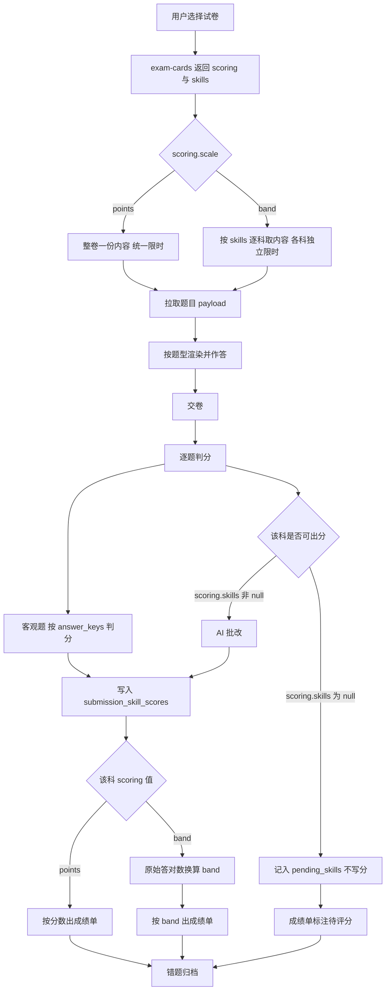
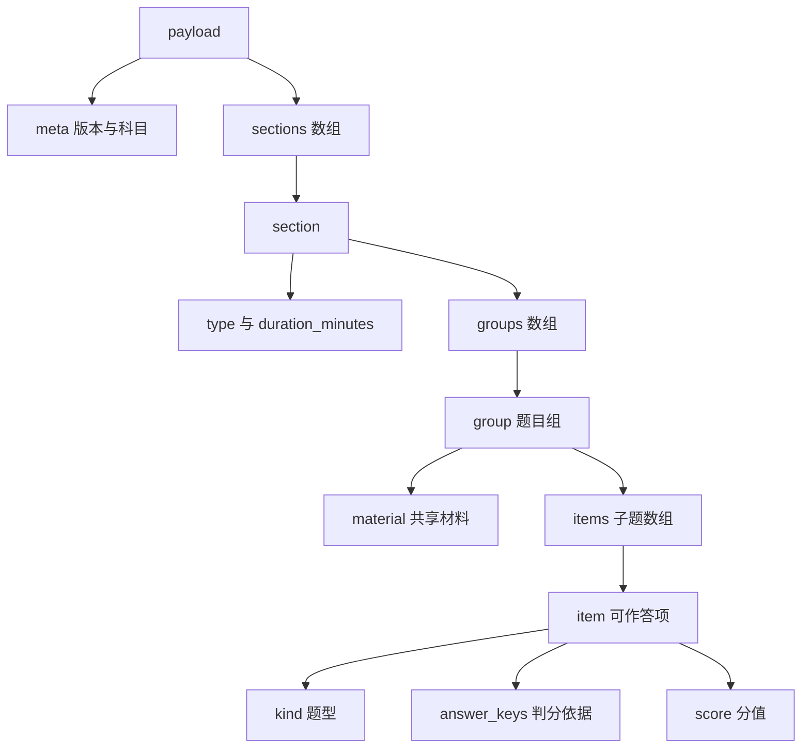

# 设计文档：考试内容与题型模型（四六级 / 雅思学术类）

- 日期：2026-10-15
- 状态：草稿

## 1. 需求理解

在既有方案 `0001-考试备考平台技术方案.md` 的基础上，收敛一期范围为**英语学习垂直**，并定义该范围所依赖的核心数据模型：考试内容结构（`exam_contents.payload`）、题型 schema、以及两套计分体系的共存方式。

**一期范围**：CET4、CET6、IELTS Academic 的 **Listening / Reading / Writing** 三科。

**关键约束**（来自需求方确认）：

1. 雅思**一期即支持**，且**仅学术类（Academic）**，不做培训类（General Training）。
2. 雅思**口语一期与二期均不实现**。一期不采集音频，二期亦不做口语评分。故数据模型须支持「单卷只含三科」的形态，而非假设永远四科齐全；`skills` 永不出现 `speaking`。
3. **一期各科的出分能力不同**：听力与阅读**可直接自动出分**；**写作一期不出分**，待接入 **DeepSeek** 作为批改模型后再支持出分。该差异是数据模型的一等公民（见 `scoring.skills`）。
4. 四六级与雅思的计分体系、限时方式均不同，二者必须在同一套模型内共存。
5. **总分的处理按考试类型分开**：**雅思不计算也不展示总分**，改为向用户提示官方口径（见 §2.4）；**四六级正常计算并展示官方总分**，但须同时标注「官方满分」与「一期可判分上限」两个数字。前者是禁止推算，后者是提供可核对的口径说明，两者的区别源于考试性质而非偏好。

**已确证的四六级结构**（来源：`../recon/assets/` 的 `CETExamView`、`CETExamAnswerView`、`CETExamAnalysisView` 三个 chunk）：

四六级为**整卷统一限时**，section 顺序与命名固定为四段：

```
listeningSection   + listening_time       听力部分
readingSection     + reading_time         阅读部分
translationSection + translation_time     翻译部分
writingSection     + writing_time         写作部分（含 writingImageUrl）
```

每种 section 均为「时长 + 内容」的同一形状。检出的客观题型子类包括**选词填空**、**段落匹配**、**仔细阅读**；另检出「展开题」与「主观题 / 客观题」的区分，说明**题目可嵌套子题**。

**关键假设**：

1. 雅思的题型与计分按其公开考试规范实现（0–9 band、含半分）。**注意：参照实现不含雅思**（全量 chunk 检索无 `ielts` / `雅思` 痕迹），故雅思部分**无参照可循，依据公开考试规范自行设计**。
2. **两套考试在「总分」上的处理不同，这是有意的**（需求方已确认）：
   - **雅思：无总分**。其总分是推算规则（四科平均、四舍五入到最近 0.5 band），一期缺写作得分与口语成绩，任何推算都会与官方口径不符。故**不设总分字段**，改为静态提示官方算法（见 §2.4）。
   - **四六级：有总分**。其总分是官方设定的**固定 710 分制**，由各 section 分值之和构成，不存在跨科目推算，且成绩单本身即展示总分。故 `scoring.max_score = 710`、`scoring.threshold = 425` 均正常返回，成绩单展示实际总分。
3. 一期不采集音频，但雅思听力与写作题干含音频/图表，故媒体引用字段须预留。
4. 四六级翻译仅四六级使用，雅思无此 section。
5. 写作批改模型选用 **DeepSeek**（需求方指定），二期接入。

**待确认事项**：

1. **雅思写作的官方评分描述**（Task Achievement / Coherence / Lexical Resources / Grammatical Range and Accuracy 四项各占 25%）是否需要在二期实现时逐项展示。一期写作不出分，故不影响本设计；二期需补充。
2. 雅思写作两篇任务（Task 1 图表描述、Task 2 议论文）是否按「一篇一次提交」还是「合并为一次作文提交」。本设计按**每篇独立子题**处理。
3. 二期写作出分后，四六级是否需要在总分之外再提供「写作单项分」的独立展示。一期写作不出分，故四六级总分只覆盖可判分的科目——该口径由 `scoring.scorable_max` 显式表达并须在成绩单上标注（见 §2.4），**不得**让用户把「可判分部分得分」误读为官方总分。
4. 雅思二期补齐写作后，是否给出「参考总分」并标注非官方口径。本设计一期不做，二期再议。

## 2. 接口改动

本方案不新增端点，仅**调整既有端点的响应结构**，以承载多考试类型。

### 2.1 修改：`GET /api/exams/exam-cards/`

原 `total_score` / `pass_score` 两个标量字段**删除**，其职责由新增的 `scoring` 对象承接。

| 字段 | 变更 | 说明 |
|---|---|---|
| `scoring` | **新增** | 计分模型对象，结构见 §2.3 |
| `skills` | **新增** | 本卷含有的科目数组，如 `["listening","reading","writing"]` |
| `total_duration` | **新增** | 整卷参考总时长（分钟）；雅思为各科之和 |
| `total_score` | **删除** | 由 `scoring` 承载。整卷满分可由 `payload` 的题目分值求和得出，不冗余存储（见 §3.2） |
| `pass_score` | **删除** | 由 `scoring.threshold` 承载（仅四六级有意义） |

错误码与鉴权不变。

### 2.2 修改：`GET /api/exams/submissions/{id}/analysis/`

| 字段 | 变更 | 说明 |
|---|---|---|
| `skill_scores` | **新增** | 数组，**仅含已出分的科目**；结构见 §2.3 |
| `pending_skills` | **新增** | 数组，本卷中**尚未出分**的科目（一期恒含 `writing`） |

**为什么用两个数组而非让 `skill_scores` 里带 `null` 分**：未出分与「得 0 分」是两种不同状态，用 `null` 表达易在渲染与统计中被误当作 0，从而污染平均分或触发错误的空状态判断。拆成两个字段后，前端可明确地把 `pending_skills` 渲染为「待评分」，且任何取分逻辑都不需要额外判空。

### 2.3 `scoring` 对象结构（本方案的核心新增）

雅思一期示例（合法 JSON，无注释；字段含义见下方说明表）：

```json
{
  "scale": "band",
  "precision": "half_band",
  "threshold": null,
  "skills": {
    "listening": "band",
    "reading": "band",
    "writing": null
  }
}
```

**四六级示例**（有总分；写作一期不出分，故 `scorable_max` 小于 `max_score`）：

```json
{
  "scale": "points",
  "precision": "integer",
  "max_score": 710,
  "threshold": 425,
  "scorable_max": 603.5,
  "skills": { "listening": "points", "reading": "points", "writing": null }
}
```

| 字段 | 取值 | 说明 |
|---|---|---|
| `scale` | `points`｜`band` | 整卷计分体系 |
| `precision` | `integer`｜`half_band` | 计分精度；`band` 制含半分 |
| `max_score` | 正数｜`null` | **官方满分**。`points` 制为固定值（四六级 710）；**`band` 制必须为 `null`**，因为雅思不存在「满分」概念 |
| `threshold` | 非负整数｜`null` | 及格线。仅 `points` 制有意义（四六级 425）；`band` 制必须为 `null` |
| `scorable_max` | 正数｜`null` | **一期实际可判分的满分**。等于 `skills` 中出分方式非 `null` 的各科分值之和；随二期写作出分而上调（四六级升至 710，雅思升至其四项满分对应的原始分上限）。`band` 制一期为 `null` |
| `skills` | 对象 | 键为科目名，值为该科的出分方式（`points`｜`band`）；**`null` 表示本卷该科一期不出分** |

**雅思一期示例**（无总分；`max_score` 与 `threshold` 均为 `null`）：

```json
{
  "scale": "band",
  "precision": "half_band",
  "max_score": null,
  "threshold": null,
  "scorable_max": null,
  "skills": {
    "listening": "band",
    "reading": "band",
    "writing": null
  }
}
```

**为什么需要 `max_score` 与 `scorable_max` 两个字段**：四六级的官方总分是 710，但一期写作不出分，因此实际能判出的分数上限低于 710。若只保留一个「满分」字段，就必须在两种错误中选一种——要么对外宣称满分 710 而让用户算出「怎么永远差 106.5 分」，要么把满分报成可判分上限而误导用户以为考试总分变了。用两个字段分别表达「官方满分」与「一期可判分上限」，并在成绩单上同时标注，是唯一不产生歧义的表达。

> 示例中 `scorable_max = 603.5` 的算法：四六级写作占 15%，即 `710 × 0.15 = 106.5`；写作一期不出分，故可判分上限为 `710 − 106.5 = 603.5`。**该值必须由配置与 `scoring.skills` 共同推出，不得硬编码**——四六级各题型的分值权重以对应考试大纲为准，若权重与上例不同，`scorable_max` 随之改变。二期写作出分后该值升至 710。

**设计要点**：`skills` 的值是该科目的**出分方式**，`null` 明确表示「本卷该科暂不出分」。把这一差异放在试卷元数据上、而非散落在判分代码的条件分支里，使得：

- 前端据 `scoring.skills` 直接决定渲染分数还是「待评分」，无需硬编码「哪些科目不可评分」；
- 二期接入 **DeepSeek** 批改后，只需把 `writing` 由 `null` 改为 `"points"`、把 `scorable_max` 升至 710 并重新出分，**无需改动判分逻辑的结构**；
- 同一套结构同时表达四六级（三科 `points` + 有总分）与雅思一期（两科 `band` + 无总分），不引入分叉。

`skill_scores` 的元素结构：

```json
{ "skill": "reading", "raw_score": 30, "max_raw": 40, "band": 7.0, "scoring": "band" }
```

### 2.4 总分的处理（两套考试规则不同）

需求方确认：**雅思不给总分，但提示算法；四六级有官方总分**。二者的区别不是偏好，而是由考试本身的性质决定——雅思总分是跨科目的推算规则，四六级总分是官方设定的固定分制。

#### 雅思：只提示口径，绝不计算

**规则**：

1. **服务端不返回任何总分字段**。不设 `overall_band`、`total_band` 之类的键，也不在 `skill_scores` 中附加汇总项。
2. **提示文案为静态展示内容**，说明官方口径与所需数据，**不代入用户的实际得分**。即：可以写「雅思总分为听力、阅读、写作、口语四项的算术平均，再四舍五入到最近的 0.5 分」，但**不得**写成「你的听力 7.0 与阅读 6.5，平均约 6.75，约 6.5 分」——后者已经是计算，且因缺写作得分与口语成绩而与官方口径不符。
3. 提示须同时说明**当前无法给出总分的原因**（写作未评分、口语未开放），避免用户误以为本平台漏算。

**建议文案**（可按设计调整，但须保留上述三点语义）：

> 雅思总分是听力、阅读、写作、口语四项成绩的平均值，四舍五入到最近的 0.5 分。
> 本站目前只提供听力与阅读成绩，写作评分与口语尚未开放，因此**无法给出官方总分**，请勿以现有两项推算。

**为什么不在服务端「顺便算一下」**：官方总分需四科齐全，一期缺两项；给出一个基于两项的近似值会与用户在官网查到的分数不符，属于误导。因此宁可不给数值，只给口径。

#### 四六级：正常给出总分，但必须标注口径

四六级的总分（710 分制、425 分及格）是官方固定值，各 section 分值之和即构成满分，不存在跨科目推算，故**服务端直接计算并返回实际总分**，成绩单正常展示。

但一期**写作不出分**，因此存在一个必须处理的歧义：用户看到的总分不可能是 710。为此：

1. 成绩单在总分旁**必须同时标注**「官方满分 710」与「本次可判分部分满分 603.5」两个数字，取自 `scoring.max_score` 与 `scoring.scorable_max`。
2. **不得**把 `scorable_max` 当作官方满分展示，也**不得**在写作未评分时宣称用户「得了 X / 710」——该表述会让用户误以为写作已计入且得了 0 分。
3. 建议文案：

> 本次得分 480 / 710
> 其中写作部分尚未评分（写作与其他可判分科目合计满分 603.5），本平台暂不计入总分。

4. 二期写作出分后，`scorable_max` 升至 710，该标注自然消失，**无需改动成绩单结构**。

**实现载体**：雅思的提示为前端静态文案或由 `scoring` 对象派生的展示规则，**不新增接口字段**；若将提示放入接口响应，须确保其中不含用户实际得分的代入值。四六级的总分由服务端计算（`submission_skill_scores` 各行 `raw_score` 之和，或按 `scoring` 权重汇总），随成绩接口返回。

**两套规则的对照**

| | 雅思 | 四六级 |
|---|---|---|
| 服务端返回总分 | ❌ 不返回 | ✅ 返回 |
| 前端展示总分 | ❌ 只展示官方口径说明 | ✅ 展示，并标注可判分范围 |
| 依据字段 | — | `scoring.max_score` 与 `scoring.scorable_max` |
| 为何不同 | 总分是跨科目推算，一期数据不足 | 总分是官方固定分制，不存在推算 |

## 3. 数据库改动

### 3.1 修改：`exam_cards`

在 `0001` 文档 §3.1 的基础上调整如下列：

| 字段 | 类型 | 约束 | 说明 |
|---|---|---|---|
| `scoring` | jsonb | NOT NULL | 计分模型，结构见 §2.3 |
| `skills` | jsonb | NOT NULL, default `["listening","reading","writing"]` | 本卷含有的科目 |
| `total_duration` | smallint | NOT NULL, default 0 | 整卷参考总时长（分钟） |
| `total_score` | — | **删除** | 由 `payload` 分值求和得出 |
| `pass_score` | — | **删除** | 由 `scoring.threshold` 承载 |

变更 DDL：

```sql
ALTER TABLE exam_cards
  ADD COLUMN scoring        jsonb    NOT NULL DEFAULT '{}',
  ADD COLUMN skills         jsonb    NOT NULL DEFAULT '["listening","reading","writing"]',
  ADD COLUMN total_duration smallint NOT NULL DEFAULT 0;
ALTER TABLE exam_cards DROP COLUMN IF EXISTS total_score;
ALTER TABLE exam_cards DROP COLUMN IF EXISTS pass_score;
```

**为什么用 `skills` 数组而非 `has_speaking` 布尔列**：口语在一期与二期**均不实现**，若用布尔列则等于为一个永不出现的科目固化一个维度。数组可同时表达单卷所含科目、未来的单科专项练习卷，且前端过滤「只练听力」时直接查数组包含。

### 3.2 关于「整卷满分」：入 `scoring` 而不落独立列

原设计的 `total_score` 标量列被删除，其职责由 `scoring` 对象内的两个值承接，理由是二者的**可推导性不同**：

- **可推导的部分**：整卷满分等于全部子题分值之和（四六级按 710 分制分配各题分值；雅思各题均为 1 分共 40 分）。因此 `payload` 是分值的唯一来源，**应在内容发布时由 `payload` 计算一次并写入 `scoring.max_score`**，而非要求编辑者手工再填一个可能不一致的数字。
- **不可推导的部分**：四六级的 710 与 425 是考试机构规定的外部约定。710 恰等于正确分配下的分值之和（可作为校验），**425 则完全不可推导**，故必须显式存储于 `scoring.threshold`。
- **一期特有的第三个值**：`scoring.scorable_max`（可判分满分）一期因写作不出分而低于 `max_score`，二期升至相等。它是「当前能判出的上限」，同样不可从 `payload` 单独推出——必须结合 `scoring.skills` 中哪些科目非 `null` 才能算出，故显式存储。

> 三者关系可用一条不变量描述：`scorable_max` 应等于 `skills` 中出分方式非 `null` 的各科分值之和，且写作二期出分后 `scorable_max == max_score`。该不变量应在应用层校验（见 §7）。

**为什么不再保留一个独立的 `total_score` 列**：若同时存在 `scoring.max_score` 与 `exam_cards.total_score`，二者语义重叠，必然出现「哪个才是权威值」的歧义。将满分、及格线、可判分上限三者**收拢进同一个 `scoring` 对象**，使计分模型只有一个权威位置。

### 3.3 修改：`exam_contents.payload` 的结构

`payload` 保持 jsonb，结构在 §4.2 定义并冻结为一期契约。新增两列：

| 字段 | 类型 | 约束 | 说明 |
|---|---|---|---|
| `schema_version` | smallint | NOT NULL, default 1 | payload 结构版本，便于演进而无需改表 |
| `skill` | varchar(16) | NULL | 本内容所属科目；四六级整卷一份内容时留空 |

`skill` 列用于雅思按科取内容（各科独立解密、独立限时）。

### 3.4 新增：`submission_skill_scores`

承载逐科得分。四六级整卷可写入一条（`skill` 为 `null`），便于两套体系共用一张表。

| 字段 | 类型 | 约束 | 说明 |
|---|---|---|---|
| `id` | bigint | PK, 自增 | |
| `submission_id` | bigint | FK→submissions, NOT NULL | |
| `skill` | varchar(16) | NULL | `listening`｜`reading`｜`writing`；四六级整卷为 NULL |
| `raw_score` | numeric(6,2) | NOT NULL | 原始得分：points 制为分数，band 制为答对题数 |
| `max_raw` | numeric(6,2) | NOT NULL | 原始满分：points 制为满分，band 制为题目总数 |
| `scoring` | varchar(16) | NOT NULL | `points`｜`band`，标明该行如何解读 |
| `band` | numeric(2,1) | NULL | band 制换算结果，如 6.5；points 制为 NULL |
| `scored_at` | timestamptz | NOT NULL | 出分时间 |
| `created_at` / `updated_at` | timestamptz | NOT NULL | |

索引：`(submission_id)`；唯一约束 `(submission_id, skill)`。

**不出分的科目没有行**。写作一期不出分，故不写行；前端据上表 §2.2 的 `pending_skills` 渲染「待评分」。这样「未出分」不会被误存为 `0`。

**为何 `raw_score`/`max_raw` 与 `band` 分开存**：band 换算规则会变（雅思官方评分表偶有调整）。保留原始答对数使得**换算规则更新后可以重算历史成绩**；若只存 band，规则一变旧数据即永久失真。`scoring` 列则让同一张表可以混存两种解读方式而无需靠 `skill` 名推断。

**落地 DDL 与回滚**：

```sql
CREATE TABLE submission_skill_scores (
  id            bigserial PRIMARY KEY,
  submission_id bigint NOT NULL REFERENCES submissions(id) ON DELETE CASCADE,
  skill         varchar(16),
  raw_score     numeric(6,2) NOT NULL,
  max_raw       numeric(6,2) NOT NULL,
  scoring       varchar(16) NOT NULL,
  band          numeric(2,1),
  scored_at     timestamptz NOT NULL DEFAULT now(),
  created_at    timestamptz NOT NULL DEFAULT now(),
  updated_at    timestamptz NOT NULL DEFAULT now(),
  CONSTRAINT uq_submission_skill UNIQUE (submission_id, skill)
);
CREATE INDEX idx_skill_scores_submission ON submission_skill_scores (submission_id);

-- 回滚
DROP TABLE IF EXISTS submission_skill_scores;
ALTER TABLE exam_cards DROP COLUMN IF EXISTS scoring;
ALTER TABLE exam_cards DROP COLUMN IF EXISTS skills;
ALTER TABLE exam_cards DROP COLUMN IF EXISTS total_duration;
ALTER TABLE exam_contents DROP COLUMN IF EXISTS schema_version;
ALTER TABLE exam_contents DROP COLUMN IF EXISTS skill;
```

## 4. 流程图

### 4.1 取题到出分的链路



### 4.2 `payload` 结构（一期契约）

题目统一建模为「**题目组 + 子题**」。依据是参照实现中同时存在「展开题」「段落匹配题」等共享同一份材料的形态：用「组」承载材料、用「子题」承载可作答项，可覆盖全部已检出题型而无需为每种题型单独设计顶层结构。



`sections[].type` 取值固定为四种：`listening`｜`reading`｜`writing`｜`translation`（后者仅四六级使用）。

#### 4.2.1 字段契约

| 路径 | 类型 | 必填 | 说明 |
|---|---|---|---|
| `meta.schema_version` | int | 是 | 固定 `1`。加载器须容忍未知的额外字段，仅在版本号不认识时失败 |
| `meta.skill` | string | 雅思必填 | `listening`｜`reading`｜`writing`；四六级整卷为 `null` |
| `sections[]` | array | 是 | 顺序即考试顺序，前端按序渲染 |
| `sections[].type` | string | 是 | `listening`｜`reading`｜`writing`｜`translation` |
| `sections[].title` | string | 是 | 展示名，如「听力部分」 |
| `sections[].duration_minutes` | int | 是 | 该 section 限时。四六级整卷限时下各 section 仍标注参考时长，**以卷级 `total_duration` 为准** |
| `sections[].groups[]` | array | 是 | 题目组，可含多组 |
| `groups[].material` | object | 否 | 共享材料；无材料的独立题可省略 |
| `groups[].material.kind` | string | 是（若有） | `passage`｜`audio`｜`image`｜`mixed` |
| `groups[].material.passages` | array | 否 | `[{id, title, paragraphs: [{label, text}]}]`，保留段落标签以便「段落匹配」引用 |
| `groups[].material.media` | array | 否 | `[{type, url, duration_seconds?}]`；一期仅存引用，不做实际存储 |
| `groups[].instructions` | string | 否 | 组级作答说明 |
| `groups[].items[]` | array | 是 | 子题；**长度为 1 时仍必须是数组** |
| `items[].id` | string | 是 | 卷内唯一，如 `L1-3`；判分与错题归档以此为准 |
| `items[].kind` | string | 是 | 见下方题型取值表 |
| `items[].stem` | string | 是 | 题干。填空题含占位标记（建议 `{{1}}`、`{{2}}`）以定位空位 |
| `items[].options` | array | 单选取值时必填 | `[{key, text}]` |
| `items[].answer_keys` | array | 客观题必填 | 判分依据。**数组**语义：单选为单元素；多空填空按空序对应；匹配题为各空的可接受取值 |
| `items[].answer_keys[].accept` | array | 是 | 可接受的写法变体，任一命中即算对 |
| `items[].score` | number | 是 | 该题分值。四六级按 710 分制分配实际分值；雅思各题均为 1（共 40 分），band 按答对数换算 |
| `items[].graded` | string | 是 | `auto`（按 `answer_keys` 判分）｜`ai`（AI 批改）｜`none`（一期不出分） |
| `items[].word_limit` | int | 否 | 作文/翻译字数下限提示 |
| `items[].reference_answer` | string | 否 | 参考答案，用于 AI 不可用时降级展示 |

**关于 `items[].graded` 取代原 `ai_graded` 布尔**：原设计中「是否 AI 批改」由布尔表达，但一期出现第三种状态——**写作题既不走 AI、也不出分**（`none`）。用枚举而非布尔可如实表达三态，避免出现「`ai_graded=false` 但又不判分」这种布尔无法区分的情形。

**`items[].kind` 一期取值与判分方式**

| kind | 含义 | 作答形态 | 判分 |
|---|---|---|---|
| `single_choice` | 单选 | 选一个 option | 严格等值 |
| `multi_blank` | 多空填空（含选词填空） | 每空一个值 | **按空计分**，非全对即零分；空数由 `answer_keys` 长度决定 |
| `matching` | 匹配（段落匹配、标题匹配） | 每空一个取值 | 同 `multi_blank` |
| `judge` | 判断题 | `True`｜`False`｜`Not Given` | 严格等值，**三值独立，`Not Given` 不得与 `False` 合并** |
| `short_answer` | 简答 | 自由文本（短） | AI 批改；一期若所属科不出分则为 `none` |
| `essay` | 作文 | 长文本 | 一期 `graded = "none"`（不出分）；二期接入 DeepSeek 后改为 `"ai"` |
| `translation` | 翻译（仅四六级） | 中译英段落 | 同 `essay` |

#### 4.2.2 完整示例（雅思学术类阅读）

```json
{
  "meta": { "schema_version": 1, "skill": "reading" },
  "sections": [
    {
      "type": "reading",
      "title": "阅读部分",
      "duration_minutes": 60,
      "groups": [
        {
          "material": {
            "kind": "passage",
            "passages": [
              {
                "id": "P1",
                "title": "The Development of the Modern Bicycle",
                "paragraphs": [
                  { "label": "A", "text": "The bicycle has a history..." },
                  { "label": "B", "text": "Early designs varied widely..." }
                ]
              }
            ]
          },
          "instructions": "Choose the correct letter, A, B, C or D.",
          "items": [
            {
              "id": "R1-1",
              "kind": "single_choice",
              "stem": "According to the passage, the first bicycles were designed mainly for",
              "options": [
                { "key": "A", "text": "recreation" },
                { "key": "B", "text": "transport" },
                { "key": "C", "text": "competition" },
                { "key": "D", "text": "military use" }
              ],
              "answer_keys": [ { "accept": ["A"] } ],
              "score": 1,
              "graded": "auto"
            },
            {
              "id": "R1-2",
              "kind": "judge",
              "stem": "The passage states that early bicycles were cheaper than horses.",
              "answer_keys": [ { "accept": ["Not Given"] } ],
              "score": 1,
              "graded": "auto"
            }
          ]
        }
      ]
    }
  ]
}
```

**关于「题目组」抽象的说明**：示例中一个 `groups[]` 元素承载一篇文章，其下两个 `items[]` 共享该材料。这一形态同时覆盖雅思阅读（一文多题）、雅思听力（一音频多题）、四六级听力与四六级仔细阅读，故无需为各题型分别设计顶层结构。独立单题（如四六级翻译）以「无 `material` 的组 + 单个 item」表示，结构不塌陷。

## 5. 范围边界

**本次做**：

- `exam_cards` 新增 `scoring`、`skills`、`total_duration`，删除 `total_score`、`pass_score`。
- 定义并冻结 `payload` 一期结构：`meta` ＋ `sections[]` ＋ `groups[].material` ＋ `groups[].items[]`（含 `graded` 三态）。
- 支持题型：单选、多空填空、匹配（段落匹配、标题匹配）、判断（True/False/Not Given）、简答、作文、翻译。
- 对「题目组 + 子题」的嵌套结构建模，支持雅思阅读/听力「一份材料多道子题」。
- `submission_skill_scores` 表，支持四六级整卷单条与雅思逐科多条共表，且**未出分的科目不写行**。
- **雅思 A 类听力与阅读的出分**：按原始答对数换算到 0–9 band（含半分）。
- **雅思 A 类写作的作答与保存**：可作答、可提交、可回看，但**不出分**。
- `pending_skills` 机制：成绩单明确标注未出分科目。

**明确不做**：

- **写作评分**（雅思与四六级作文均含）。一期 `graded = "none"`，该科不出分；二期接入 **DeepSeek** 批改后支持出分。
- **雅思口语**（**一期与二期均不做**）。不实现音频采集、上传、回放与口语评分；`payload` 不定义口语 section 类型，`skills` 永不出现 `speaking`。
- **雅思培训类（General Training）**。阅读与写作题型不同，本设计不为 G 类预留分支。
- **雅思的总分计算与展示**。服务端不返回总 band 字段，前端不显示总分，**不得**用现有科目的平均值冒充；替代做法是 §2.4 的静态口径提示。**注意此项仅适用于雅思**：四六级的官方总分正常计算与展示，见 §2.4。
- 四六级与雅思的混合卷、跨考试类型的成绩对比。
- 音频与图片的实际存储实现（仅预留媒体引用字段）。
- 题目内容的加密（沿用 `0001` 文档：首期 `is_encrypted = false`）。

## 6. 验收标准

- [ ] Given 一张 CET4 试卷，When 查询 `/api/exams/exam-cards/`，Then 返回的响应中**不含** `total_score` 与 `pass_score` 字段，且 `scoring` 为 `{"scale":"points","precision":"integer","max_score":710,"threshold":425,"scorable_max":603.5,"skills":{"listening":"points","reading":"points","writing":null}}`。
- [ ] Given 一张 IELTS Academic 试卷，When 查询 `/api/exams/exam-cards/`，Then `scoring.scale = "band"`，且 `scoring.max_score`、`scoring.threshold`、`scoring.scorable_max` **三者均为 `null`**。
- [ ] Given 一期雅思试卷，When 查看其 `skills`，Then 值为 `["listening","reading","writing"]` 且**不含 `speaking`**。
- [ ] Given 一期雅思试卷，When 查看 `scoring.skills.writing`，Then 值为 `null`。
- [ ] Given 一份四六级试卷，When 对 `payload` 全部 `items[].score` 求和，Then 结果等于 `scoring.max_score`（710），以证明分值分配完整。
- [ ] Given 一份四六级试卷且写作未出分，When 计算可判分科目分值之和，Then 结果等于 `scoring.scorable_max`，且该值**严格小于** `scoring.max_score`。
- [ ] Given 一份四六级 submission，When 查询成绩，Then 响应**包含**总分，且该总分等于各已出分科目 `raw_score` 之和。
- [ ] Given 四六级成绩页且写作未出分，When 用户查看成绩，Then 页面**同时展示**「官方满分 710」与「本次可判分部分满分 603.5」两个数字，且**不出现**「得分 X / 710」这类会让用户误以为写作已计 0 分的表述。
- [ ] Given 一期雅思 submission，When 查询成绩，Then 响应中**不存在**任何表示总分的字段（不出现 `overall_band`、`total_band`、汇总项或平均分）。
- [ ] Given 雅思成绩页，When 用户查看成绩，Then 页面展示官方总分口径提示，且该提示文案**不含用户的实际得分数字**，并说明当前无总分的原因（写作未评分、口语未开放）。
- [ ] Given 二期写作出分后的四六级试卷，When 计算可判分上限，Then `scorable_max == max_score == 710`，且成绩单上的「可判分部分」标注自动消失。
- [ ] Given 一份含多道子题的听力内容，When 解析 `payload`，Then 该组对应一个 `groups[]` 元素、其 `material` 含音频引用、`items[]` 含多条子题，且子题数为 1 时结构不塌陷为对象。
- [ ] Given 一道 `single_choice` 题，When 以正确选项交卷，Then 该题判定为正确且计入 `raw_score`。
- [ ] Given 一道 `multi_blank` 题含 3 个空，When 答对 2 个，Then 判定为部分得分（非全对即零分）。
- [ ] Given 一道 `judge` 题，When 提交 `Not Given`，Then 该答案被接受为独立取值，不与 `False` 合并。
- [ ] Given 雅思阅读 40 题答对 30 题，When 交卷，Then `submission_skill_scores` 写入 `skill='reading'`、`raw_score=30`、`max_raw=40`、`scoring='band'`，且 `band` 按当期官方换算表得出（如 30 题对应 band 7.0）。
- [ ] Given 雅思写作已提交，When 查询成绩，Then `submission_skill_scores` 中**不存在** `skill='writing'` 的行，且 `pending_skills` 包含 `"writing"`。
- [ ] Given 雅思听读写三科均已提交，When 查询成绩，Then `skill_scores` 恰含 2 项（listening、reading），`pending_skills` 恰含 1 项（writing）。
- [ ] Given 一张 CET4 试卷交卷，When 查询 `submission_skill_scores`，Then 恰有一条记录且 `skill` 为 `null`。
- [ ] Given 同一份 submission，When 重复写入同一 `skill` 的得分，Then 唯一约束拒绝，不产生两条。
- [ ] Given 某试卷的 `payload` 已发布，When 对其全部 `items[].score` 求和，Then 结果等于该卷满分（四六级为 710，雅思为 40），**无需读取任何试卷级满分字段**。
- [ ] Given 一道 `essay` 题，When 查看其 `graded`，Then 值为 `"none"`（一期），且交卷时该题不进入任何判分路径。
- [ ] Given 一道 `short_answer` 题且所属科在 `scoring.skills` 中为 `null`，When 交卷，Then 该题不判分且该科进入 `pending_skills`。
- [ ] Given `payload` 的 `schema_version` 为 1，When 加载器读取该内容，Then 按版本 1 的结构解析，且不因未知的额外字段而失败。
- [ ] Given 雅思写作两篇任务，When 用户提交，Then 两篇作为两个独立子题分别记录，不合并为一条。

## 7. 影响面

**受影响的既有设计**

- 修改 `0001` 文档 §3.1（`exam_cards` 增列、删除 `total_score`/`pass_score`）与 §3.2（`exam_contents` 增列）。**删除列是破坏性变更**，但本项目尚未上线，无存量数据。
- `0001` 文档 §5 的范围边界已同步修订为英语垂直；考研移出一期。
- `0001` 文档 §2.2 中原写的 `"total_score": 710`、`"pass_score": 425` 在真实响应示例中出现过，该示例反映的是参照实现的字段；本项目**不沿用**，已在本文件 §3.2 说明理由。

**性能**

- `payload` 体积显著增大：雅思阅读单篇材料可带十余道子题，整卷 `payload` 可能达数百 KB。故**必须按 skill 分段取内容**（见 §3.3 的 `skill` 列），避免整卷一次性下发。列表接口不触碰 `payload`（已由 `0001` §3.2 的分表保证）。
- 整卷满分改为由 `payload` 求和得出，意味着列表页若需展示满分，需要一次跨 `exam_contents` 的计算。**应在内容发布时预计算并缓存到 `exam_cards`**，避免列表接口实时求和。若实现时发现缓存列不可避免，可加回一个只读的 `computed_total_score` 列（由发布流程写入，不接受人工编辑）——这不等同于原先可手工填写的 `total_score`。
- `skills` 用 jsonb 存数组，若将来出现「按 skill 过滤试卷列表」的高频查询，需建 GIN 索引；一期试卷量级下不建。

**兼容性与一致性**

- `scoring` 为 jsonb，其内部结构（`scale`/`precision`/`max_score`/`threshold`/`scorable_max`/`skills`）**无法由数据库约束强制**。必须在应用层校验：`scale = "points"` 时 `max_score` 与 `threshold` 应为非负整数；`scale = "band"` 时 `max_score`、`threshold`、`scorable_max` **三者必须均为 `null`**；`precision` 与 `scale` 的配对关系同样需校验。这些校验须在写入试卷时执行并纳入测试。
- `scoring.skills` 的键集合应与 `skills` 数组一致，否则会出现「某科在 `skills` 中但无出分声明」的歧义。该一致性应在应用层校验。
- **一条必须校验的不变量**：`scorable_max` 等于 `skills` 中出分方式非 `null` 的各科分值之和；且当所有科目均已出分时 `scorable_max == max_score`。该不变量在一期因写作不出分而**故意不成立**（603.5 ≠ 710），故校验须允许「部分科目未出分」这一合法状态，仅拒绝「`scorable_max` 与实际可判分科目之和不符」。
- **不得用 `0` 表达未出分**：写作一期不写 `submission_skill_scores` 行，而非写 `raw_score = 0`。这是 §2.2 拆出 `pending_skills` 的原因，也是验收项。
- 雅思 band 换算表为**外部规则**，须以配置或代码常量集中存放并标注来源与版本，不得散落于判分逻辑。规则更新后应能重算历史成绩——这是 §3.4 保留 `raw_score` 的原因。

**合规**

- 雅思（IELTS）为英国文化教育协会、IDP、剑桥大学考评院共有的注册商标与考试体系。本项目实现的是**备考练习功能**，不得使用官方标识、不得声称官方认证、不得复制官方真题内容。题目须自建或取得授权（沿用 `0001` 文档的合规边界）。

## 8. 回滚方案

**代码回滚**

- 新增列均有 `DEFAULT`，旧代码在新增列存在时仍可运行。但**删除 `total_score`/`pass_score` 后，依赖这两列的旧代码会失败**，故本次代码回滚必须与数据库回滚同步进行，不能只回滚其一方。

**数据回滚**

- 按 §3.4 的 DDL 逆序执行：先 `DROP TABLE submission_skill_scores`，再逐列 `DROP COLUMN`。
- **`total_score`/`pass_score` 已删除，若回滚代码则必须同时恢复这两列**，并接受其值为空（原始值不可恢复，除非从备份还原）：

```sql
ALTER TABLE exam_cards ADD COLUMN total_score smallint;
ALTER TABLE exam_cards ADD COLUMN pass_score  smallint;
```

- 由于 `payload` 的一期结构与原设计不同（`graded` 取代 `ai_graded`），已写入的 `exam_contents` 行在代码回滚后将无法被旧加载器解析。回滚前须确认无已发布的雅思内容，或准备数据迁移脚本。

**开关与降级**

| 能力 | 开关 | 降级行为 |
|---|---|---|
| 雅思支持 | `FEATURE_IELTS` | 关闭后试卷列表过滤掉 `scoring.scale = "band"` 的试卷，前端不显示雅思入口；已有雅思 submission 仍可查看 |
| 雅思 band 显示 | `FEATURE_IELTS_BAND` | 关闭后雅思成绩只显示原始答对数，不显示 band |
| 写作出分 | `FEATURE_WRITING_SCORING` | 一期关闭。关闭时写作科目在 `pending_skills` 中；二期接入 DeepSeek 后开启，改为写入 `submission_skill_scores` 并从 `pending_skills` 移除 |
| AI 批改 | `FEATURE_AI_GRADING` | 沿用 `0001` 文档：关闭后仅展示参考答案 |

**一期范围内不可回滚的项**：`payload` 结构一经写入数据即成为事实契约，故 `schema_version` 字段必须在一期就落地，使后续结构演进可版本化，而非依赖回滚。
